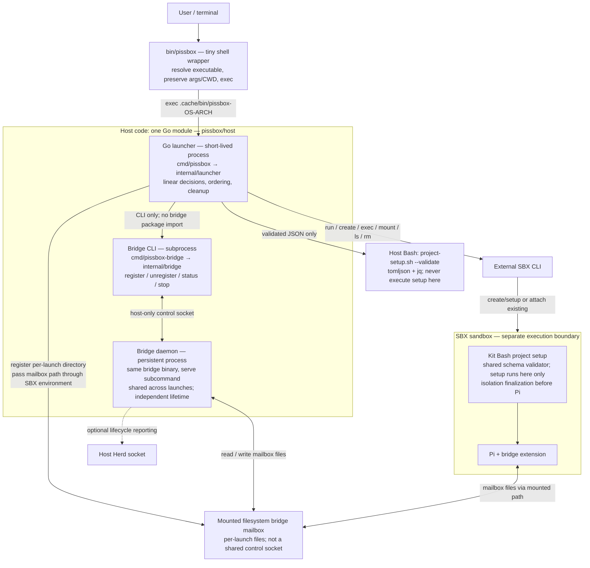

# Go launcher migration

## Goal and scope

Replace the behavioral implementation of `bin/pissbox` with Go while preserving its straightforward, linear orchestration and existing launch behavior. Make launcher decisions accessible to the repository's Go mutation-testing workflow.

This document is a plan only; creating or editing it does not authorize starting implementation. Once the user authorizes a phase on the dedicated migration branch, the implementing agent may commit that phase's changes at sensible checkpoints without asking for each commit. Dependency installation and sandbox recreation still require separate authorization.

## Decisions and constraints

- Use one Go module for host code, with separate launcher and bridge executables. The persistent bridge daemon and short-lived launcher retain independent lifecycles.
- Prepare the existing bridge layout first, before adding launcher implementation. Keep this structural change separate from behavior changes.
- Keep the bridge CLI/mailbox protocol unchanged during migration. Sharing a module does not require sharing daemon internals with the launcher.
- Use the Python subprocess tests as the compatibility specification during the port. Later, move behavioral coverage into Go tests for mutation testing; retain or port useful end-to-end acceptance tests. Permanent test-language choices are not a blocker.
- Keep shell where it is appropriate: sandbox project setup and, if needed, a small host executable-selection wrapper. Host behavior and safety decisions move to Go.
- Preserve one shared project-schema validator initially. The current host path invokes `project-setup.sh --validate`; removing Bash, tomljson, or jq is not part of the initial port.
- No command framework, generic state-machine framework, speculative shared packages, or broad dependency-injection layer. Introduce narrow test seams at actual IO boundaries.
- Preserve unrelated working-tree changes. Reinspect `git status --short` and the current diff at execution time; do not reset, stash, or overwrite ongoing work. The compatibility reference is the working-tree launcher and tests, not a clean version from Git.
- Do not fix unrelated launcher quirks during translation. If source and tests disagree or a new safety issue appears, record the exact case and ask before changing the contract.
- Go tests are added with each behavioral slice, not postponed until the entire port works. Python tests provide transition confidence; Go tests must independently exercise the decisions that mutation testing will assess.

## Execution protocol for the implementing agent

1. Read this entire plan, root `AGENTS.md`, affected files, and applicable skills. Run `make help`. This plan does not authorize execution by itself; follow the user's requested phase or scope.
2. Work on one authorized phase at a time. Mark one current task `[!]`; mark it `[x]` only after its checks pass. Phase 2 may be one sustained implementation run, but verify its internal slices incrementally. Do not perform the module move, launcher port, default switch, and cleanup in one unverified batch.
3. At each phase boundary, record changed paths, exact commands, actual results, manual checks, deviations, and outstanding failures in the execution record below. Stop for human review and authorization of the next phase. A new session is optional: continue or restart using this same plan and current repository state. Do not silently skip unavailable checks or label a dry run a mutation assessment.
4. A failure with no recorded baseline explanation blocks advancing. Missing tools, uncertainty about an external contract, or a need for a new dependency must be reported rather than bypassed. No weakening assertions, blanket mutation exclusions, automatic tool installation, or contacting the real bridge to make checks pass.
5. The user will provide a dedicated migration branch. Confirm the current branch before implementation; do not guess or switch branches automatically. Commits within the authorized phase are permitted under the rules below. Dependency installation, destructive cleanup outside the approved phase scope, real SBX creation/deletion, and publication still require separate authorization. Never use `git add -A` against unexplained private/unrelated files.

## Commit rules

- Use as many commits per phase as make sense for coherent, reviewable changes; there is no one-commit-per-phase requirement or fixed commit count. Do not manufacture tiny commits just to split the work. Committing does not authorize starting the next phase or bypass its review gate.
- Every migration commit subject must begin with `phase N:`, where `N` is the execution phase (1–4). This includes code, tests, tooling, documentation, and plan-status updates. Keep commits within one phase; split changes spanning phase boundaries.
- Examples: `phase 1: relocate bridge into host module`, `phase 2: preserve readiness checks in Go launcher`, `phase 3: switch installed launcher to Go`, `phase 4: remove legacy launcher and duplicate tests`.
- Follow the commit-message skill. Keep the remainder of the subject specific; use the body for meaningful rationale, not test counts or routine verification logs. Stage only reviewed migration files and preserve unrelated work.
- Record checkpoint commit hashes in the phase's execution record so later work can identify its starting point. Do not amend/rewrite existing history or push without authorization.

## Planned implementation defaults

These make the handoff concrete; they are implementation choices proposed by this plan, not additional requirements already agreed in conversation. Resolve objections before implementation, not halfway through the port.

- Module path: `pissbox/host`; Go minimum remains 1.25. No `go.work` or second host module.
- Keep `bin/pissbox` as a tiny shell wrapper at final cutover. Its only jobs are resolving its own symlink chain, selecting the native executable, reporting a missing/unsupported executable, and `exec` with untouched arguments. No automatic compilation, fallback to the old launcher, config parsing, settings changes, bridge calls, menus, or SBX calls in the wrapper.
- Launcher artifacts: `.cache/bin/pissbox-<os>-<arch>` for the same four platforms as the bridge. Preserve `.cache/bin/go-bridge-<os>-<arch>` unchanged. Add `bin/build-launcher` and `make build-launcher` / `make build-launcher-all`; normal `make build` builds both host executables and the image.
- Production resource lookup: derive the checkout root from the symlink-resolved launcher executable under `.cache/bin/`; resources remain checkout-relative. Do not use caller CWD as the install root, bake an absolute checkout path into the binary, or search parent directories. Fake-checkout tests copy the binary into this same layout. Package-level tests may supply a fixture root directly without adding a public CLI override.
- Builds are explicit. Do not implement source hashing, automatic rebuilds, or timestamp freshness machinery. Acceptance tests must build a fresh candidate into isolated fixture storage, not trust a potentially stale installed executable. The wrapper's missing-binary diagnostic identifies the build command.
- Keep the bridge subprocess contract; do not import `internal/bridge` into launcher orchestration. Export only the minimal bridge entrypoint needed by `cmd/pissbox-bridge`; preserve existing exit behavior.
- No new production dependency is assumed. If terminal handling requires one, stop and propose the package, version, need, and installer impact. Do not replace PTY tests with weaker pipe-only tests to avoid the question.

## Target layout

Use a neutral `host/` directory rather than placing the launcher underneath `go-bridge/`:

```text
host/
  go.mod
  cmd/
    pissbox-bridge/
      main.go
    pissbox/                 # Added only after bridge scaffolding is verified.
      main.go
  internal/
    bridge/
      *.go
      *_test.go
    launcher/                # Added during the launcher port.
      *.go
      *_test.go
```

Keep entrypoints thin. Keep existing bridge source files together in one internal package initially; moving out of the module root does not justify splitting each file into its own package. Bridge uses `package bridge`; its existing same-package tests move with it. Launcher uses `package launcher`, with a returning orchestration entrypoint and `os.Exit` only at the executable boundary. An error or nonzero SBX result must not skip bridge cleanup. Do not extract shared packages merely because both programs occupy one module.

## Desired architecture

Target after phase 4. The module groups source/build ownership; its boxes are separate processes, not one combined application. Arrows describe runtime interactions, not Go imports.



- `cmd/` entrypoints stay thin; launcher behavior belongs in `internal/launcher`, bridge behavior in `internal/bridge`. No speculative common framework or cross-import from launcher to bridge.
- The launcher remains alive while a bridge registration is owned; normal cleanup unregisters its own ID, never stops the shared daemon. Owner monitoring handles launcher crashes.
- Host validation and sandbox setup use the same `project-setup.sh` validator. Only sandbox execution may run project setup commands. The isolation identity mailbox is a separate creation handshake, not the bridge mailbox shown above.
- Go behavioral tests exercise launcher/bridge packages and instrumented process boundaries. Existing Python acceptance tests drive the candidate executable during migration; coverage and mutation tooling target Go decisions inside this shared module.

## Behavior ledger required before porting

Record representative test names and remaining gaps for each row when phase 2 starts. Preserve argument ordering, exit status, relevant diagnostics, side-effect ordering, and absence of forbidden calls—not just the final success result. Current source/tests remain authoritative for details this table omits.

| Area                   | Contract to preserve                                                                                                                                                                                                                                                                        | Existing evidence                                                                            |
| ---------------------- | ------------------------------------------------------------------------------------------------------------------------------------------------------------------------------------------------------------------------------------------------------------------------------------------- | -------------------------------------------------------------------------------------------- |
| CLI                    | Interspersed options, repeated-value precedence, `--`, caller-relative overrides, continue forwarding, empty values, help and management early exits                                                                                                                                        | `tests/test_pissbox_start.py`                                                                |
| Management             | Validate the entire listing before any deletion; exact physical-directory matching, explicit null workspaces accepted but missing/invalid fields rejected; field-specific rejection diagnostics from current uncommitted work; one separate confirmation, EOF safe, color/NO_COLOR behavior | `tests/test_pissbox_start.py`                                                                |
| Paths/config           | Launcher symlinks do not change caller CWD; only primary config is read; configured paths relative to primary, not config symlink target; literal strings, ordered physical deduplication with retained CLI spellings; ignore-config-workspaces still validates schema                      | `tests/test_pissbox_start.py`, `tests/test_project_setup.py`                                 |
| Settings/state         | `cm` and `di-7415` select settings-go, others settings-co; preserve regular-file backup and refusal/failure behavior; canonical shared paths; invalid config/isolation checks before settings/state effects                                                                                 | `tests/test_pissbox_start.py`, `tests/test_settings_profiles.py`                             |
| Ordinary launch/attach | Only supported SBX conflicts enter menu; use reported identity; preserve unrelated/session failure status; Enter/default Pi, case-insensitive immediate keys, invalid-key retry, EOF abort; readiness before Pi/shell, not quit/delete; old kits pass                                       | `tests/test_pissbox_start.py`, `tests/test_isolated_directories.py`                          |
| Bridge                 | Optional failure never blocks Pi or replaces SBX status; owner PID stays alive for registered session; fresh registration on reattach; cleanup unregisters only this launch; crash does not kill daemon; complete/partial Herd binding behavior                                             | `tests/test_bridge_launcher.py`                                                              |
| Isolation              | Ordinary run unchanged when absent/empty; create/defer, mailbox identity without discovery, validate names, recheck path components, mount, verify marker, writable probe, finalize once as UID 1000, register bridge, run Pi; fail closed without replay/remount or automatic deletion     | `tests/test_isolated_directories.py`, `tests/test_bridge_launcher.py`                        |
| Terminal/processes     | SBX stdin/stdout retain terminal identity; stderr streams while captured, including on failure; menu reads one key; terminal restored after exit/interruption; cleanup and status preserved on signals                                                                                      | Existing PTY/process cases in launcher/bridge suites; add missing signal/restore cases in Go |

## Known source-layout consumers

This is an inspection seed, not an exhaustive allowlist. Search the tracked tree again before declaring phase 1 complete. Replace source paths, not every occurrence of the name `go-bridge`.

- `bin/build-bridge`: build from `host/` with package `./cmd/pissbox-bridge`, not the module root `.`.
- `Makefile`: test/vet/fmt/tidy working directories, recursive source discovery, syntax list, help examples, and later launcher build targets.
- `tools/quality/run.py`: source root, relative exclusion paths, coverage/CRAP/mutation working directories; recursive nested `cmd/` and `internal/` selection.
- `tools/quality/javascript.mjs`: Stryker copied-file allowlist must include nested host source plus module files, without copying private Pi state or `.cache` artifacts.
- `tests/test_build_bridge.py`, `tests/test_bridge_launcher.py`, `pi-agent/extensions/lib/agent-messaging.test.mjs`: bridge builds now name `./cmd/pissbox-bridge` from `host/`.
- `tests/test_quality.py`: nested fixture tree, exact exclusions, rename destinations, command CWD, Stryker copied-file assertions, and preserved empty-scope behavior.
- Bridge tests: fallback fixture root must still resolve to real checkout `.cache/test-fixtures/` after moving three directory levels below it. Copied-module mutation tests must use the existing explicit fixture-root environment override, not resolve outside the mutation copy by accident.
- `AGENTS.md`, `README.md`, `sbx-kit/README.md`, `KNOWN_ISSUES.md`, `GLOSARY.md`, and `tools/quality/README.md`: current source-layout references and commands. Historical plans may retain old paths; record intentional exceptions.
- `bin/artifacts`, `tests/test_artifacts.py`, `bin/install`, `tests/test_install.py`, `tests/test_make_build.py`: review during cutover. Existing bridge artifact names remain stable; add launcher artifacts, never replace them with daemon-internal names.

## Progress

Checkboxes are the task-status source of truth: `[ ]` pending, `[!]` in progress, `[x]` verified complete. Phase completion includes its review/manual gate, not just finished code. Phase 1 is accepted by the user, with normal-exit and interruption/crash cleanup checks explicitly deferred rather than claimed as verified.

- [x] Review current launcher, bridge entrypoint/process tests, build/test wiring, quality tooling, and working-tree behavior.
- [x] Record shared contracts, behavior ledger, source-layout consumers, implementation defaults, and desired-architecture diagram.
- [x] Organize one master plan into four separately authorized execution phases with checkboxes and handoff records.
- [x] Phase 1 complete: bridge relocated; automated verification and user acceptance recorded. Remaining manual cleanup checks deferred by the user (see execution record).
- [x] Phase 2 complete: Go launcher implemented, compatibility checked, and mutation-assessed. User accepted by authorizing phase 3.
- [x] Phase 3 cutover accepted: Go is default; user explicitly deferred final verification to a human post-merge checklist. Deferred checks are not claimed as passed.
- [x] Phase 4 cleanup implemented: old implementation, duplicate hostname cases, and dual harness removed; retained acceptance suites pass locally.
- [ ] Phase 4 final acceptance: post-merge human checklist and deferred final checks completed and reviewed.

## Tasks

### Phase 1. Relocate the bridge and verify with the old launcher

No launcher implementation or intended bridge behavior changes in this phase. The existing Bash launcher remains the default throughout.

- [x] Record an ordinary-check baseline before changing paths. Inspect the current diff so ongoing launcher work is preserved.
- [x] Move the Go module from `go-bridge/` to `host/`. Move bridge implementation and colocated tests into `internal/bridge`; introduce `cmd/pissbox-bridge/main.go` with a minimal entrypoint into that package.
- [x] Preserve signal handling, diagnostics, exit behavior, detached daemon startup, and self-executable invocation. Existing process tests re-execute their instrumented test binary through `TestMain`; adapt that mechanism without replacing real process tests with in-process mocks.
- [x] Update all source-layout consumers together: `bin/build-bridge`, Make test/vet/fmt/tidy targets, Python tests that build the bridge, JS messaging tests that build it, quality wrappers, Stryker copied-source allowlists, documentation, and repository instructions/examples. Search the whole tracked tree for old source paths; do not rename runtime binary paths indiscriminately.
- [x] Keep `.cache/bin/go-bridge-<os>-<arch>`, bridge protocol versions, host runtime directory selection, and launcher invocation of the bridge unchanged. Review artifact handling and installer checks; update them only where source-layout or dependency changes require it.
- [x] Make coverage, CRAP, and mutation discovery work recursively under the new module. Preserve exact-file selection, rename-destination selection, explicit-base behavior, and refusal to widen empty mutation scopes. Update quality-wrapper regression tests with nested source paths rather than merely renaming the old flat fixture directory.
- [x] Preserve isolated short fixture paths, including `PISSBOX_BRIDGE_TEST_FIXTURE_DIR`, daemon cleanup, and test-result-cache disabling. Verify an unmutated copied-module baseline before trusting mutation results; do not lose subprocess instrumentation while moving the entrypoint.

Verification and review gate:

- [x] Run `make check`; record pre-existing/environmental failures separately from regressions.
- [x] Run `make build-bridge-all` and verify all four existing platform binaries. Cross-compilation is not runtime verification.
- [x] Run `make coverage-go`, exact-file CRAP selection, and a small explicitly selected bridge mutation assessment at the new paths. Inspect baseline failures and uncovered subprocess code rather than treating them as valid kills.
- [x] Confirm messaging and Herd status through the live agent exchange and user report; user also reports successful reattach. No host command transcript or platform details were supplied for the manual checks.
- [x] Resolve the manual gate: user explicitly deferred normal-exit and interruption/crash cleanup verification. Those checks were not performed or claimed as passing; retain them as follow-up below.
- [x] Record evidence and obtain human acceptance of the bridge move before starting phase 2. User accepted phase 1 with the above deferral.

### Phase 2. Implement and verify the Go launcher in one sustained run

Keep `bin/pissbox` as the old Bash default throughout this phase. Harness adaptation, translation, Go tests, and mutation assessment belong together. The subsections below are incremental checks inside one phase, not mandatory separate sessions or human handoffs. Do not retire old code or redundant tests yet.

#### Compatibility harness

- [x] Map the current Python launcher, isolation, and bridge-launcher cases to the behavior ledger, including current working-tree behavior.
- [x] Add `cmd/pissbox` and `internal/launcher` with a returning orchestration entrypoint; keep process exit at the executable boundary so cleanup can run.
- [x] Build a separate fresh Go candidate once per acceptance-test run in `.cache/test-fixtures/`; add one shared Python harness helper for candidate selection/materialization, including copied fake checkouts and symlink launches. Do not compile independently for every test or add production fallback/test-mode behavior.
- [x] Record exact Bash and Go harness invocations in this plan. Until translation is complete, run focused relevant cases against Go and the full suite against Bash. Every original case needs a Go-candidate result or explicit equivalent-Go-test mapping; an unexplained skip is not parity.
- [x] Adapt Bash-specific fixtures without weakening their behavioral assertions. A Go `os.Hostname` call bypasses the hostname utility stub: cover profile selection through a narrow Go test seam. Test filesystem failures using real conditions where possible, not an assumption that Go invokes `mkdir`. If a Python injection cannot reasonably exercise Go, retain it for the Bash baseline and map each assertion to a passing Go test before excluding that case from candidate execution. Do not retain shell utility calls solely to satisfy old fixtures.
- [x] Add launcher build targets and ensure ordinary Go checks and scoped quality tooling discover launcher code. Ordinary tests compile isolated candidates without requiring installed binaries, `make build`, or an image build.
- [x] Prove instrumented Go process tests early: re-execute the Go test binary through a dedicated test entrypoint, as bridge tests already do. Do not build an ordinary launcher binary inside Go mutation tests and assume its decisions are instrumented.

#### Behavioral slices and Go tests

For each slice: translate the behavior, add corresponding Go tests, run focused Python compatibility cases against both implementations, and run affected ordinary checks. Preserve linear orchestration and concrete data; introduce narrow IO seams, not a universal injected operating-system interface.

- [x] Port CLI parsing and management operations. Preserve interspersed options, last-value precedence, `--`, help/list/delete early exits, complete metadata validation, exact workspace matching, and deletion confirmation.
- [x] Port resource resolution, workspace/config handling, settings-profile selection/backups, and shared-state preparation. Preserve caller-relative overrides, physical deduplication with retained CLI spellings, primary-project-relative config paths, and validation-before-side-effects ordering.
- [x] Keep host configuration processing data-only through the shared validation script; never execute project setup commands on the host.
- [x] Port ordinary creation and existing-sandbox handling. Preserve supported conflict wording/name checks, unrelated-error propagation, continue arguments, single-key menu choices, EOF, and readiness checks with old-kit compatibility.
- [x] Port bridge registration and cleanup without changing its CLI contract. Preserve owner PID semantics, fresh attach registrations, optional failure behavior, and the independent daemon lifetime.
- [x] Port isolated creation as the existing ordered protocol: deferred setup, mailbox identity, path revalidation, backing directories, mounts, marker verification before writable probes, UID 1000 finalization, then Pi. Preserve no-discovery, no-remount, and no-automatic-replay behavior.
- [x] Verify terminal stdin/stdout remain terminals while stderr streams and is captured for conflict recognition. Exercise actual process/PTY boundaries for interruption, termination, terminal restoration, owner lifetime, and child exit status; command-recording mocks alone are insufficient.

#### Compatibility and mutation verification gate

- [x] Run all applicable Python launcher/isolation/bridge-launcher compatibility cases against the fresh Go candidate, including failures. Record every implementation-coupled exception and passing Go equivalent in the behavior ledger. The ordinary suite must also still pass with the Bash default.
- [x] Audit Go tests across all ledger areas, particularly invalid config before effects, exact deletion matching, readiness before attach, verified mounts before writes/setup, no replay, conflict classification, and bridge failures not replacing SBX status. Production orchestration must remain readable in execution order.
- [x] Run ordinary checks before fresh coverage/CRAP and scoped mutation runs through existing Make targets. Prove an unmutated copied-host-module test run passes; supply isolated fixture resources explicitly instead of assuming resources exist outside the copied module.
- [x] Complete a scoped mutation assessment of at least one real launcher decision file. Inspect survivors, uncovered code, invalid mutants, and timeouts. Fix subprocess instrumentation gaps; parser-only results do not establish launcher stability. Record concrete gaps without inventing a numeric threshold or claiming unrelated failures as kills.
- [x] Record changed paths, harness commands/results, test mappings, mutation evidence, and outstanding gaps. Obtain human acceptance before switching the default in phase 3. Automated work is verified below; user accepted by requesting phase 3.

### Phase 3. Switch to Go and perform manual acceptance

Switch only after phase 2 acceptance. Originally the legacy reference was retained until manual acceptance. The user subsequently accepted proceeding to phase 4 and deferred final checks until after merge to main (see the final human checklist below); that explicit decision supersedes the pre-cleanup manual gate. Never fall back automatically.

- [x] Preserve the old working-tree Bash launcher as `bin/pissbox-legacy` before replacing `bin/pissbox`. Keep its required isolation helper and explicit test-harness selection working through this phase. This temporary reference is not selected automatically by the wrapper.
- [x] Implement the planned tiny-wrapper contract and native binary naming. Preserve launcher symlink chains and caller CWD. `~/.local/bin/pissbox` continues to point to checkout `bin/pissbox`; the wrapper must not regain behavioral logic.
- [x] Wire explicit launcher compilation into build/install and artifact export/import. Preserve refusal to overwrite regular user files, bridge filenames, and native-host selection despite inherited GOOS/GOARCH. Verify all four launcher cross-build targets and missing-binary diagnostics; no automatic rebuilding/fallback.
- [x] Align `bin/install`, installer/build/artifact tests and help, README requirements, and operational guides. Retain dependencies required by shared shell validation. Ordinary Python tests must build/select the fresh Go candidate without requiring installed artifacts.
- [x] Run `make check` with Go as the default and verify the explicit legacy-reference harness still works. Record real regressions separately from previously recorded environment gaps.
- [ ] Deferred to the post-merge human checklist: with disposable test sandboxes, manually verify ordinary create, existing attach, continue, shell, isolation creation/ready attach, failure/readiness refusal, interruption/terminal restoration, and bridge registration/cleanup. Verify no automatic setup replay or daemon shutdown. Exercise list/delete safely only on disposable resources. Record exact scenarios/results, platforms tested, and unavailable checks.
- [x] User accepted proceeding to phase 4 with all final checks explicitly deferred until after merge to main. Unperformed checks remain pending in the final human checklist; this is acceptance of the deferral, not evidence that manual verification passed.

### Phase 4. Remove the old launcher and redundant tests

Cleanup is authorized by the user's phase-4 request and explicit post-merge verification deferral. Do not redesign behavior during removal. Final build, tool/image registration, automated assessment, and manual acceptance remain human-owned pending work at the bottom of this plan.

- [x] Remove `bin/pissbox-legacy` and the obsolete isolation helper after confirming no remaining consumers. Retain the new tiny `bin/pissbox` wrapper.
- [x] Remove redundant Python cases only where equivalent Go behavioral assertions exist and are exercised. Record retained acceptance suites and removed-case-to-Go-test mappings. Retain or port useful end-to-end tests; do not delete cases solely because they are Python.
- [x] Remove temporary dual-implementation harness selection and obsolete fixtures/build paths. Keep the fresh-candidate acceptance harness needed by retained tests. Update the Bash syntax target so removal cannot leave an unmatched `bin/lib/*.sh` glob.
- [x] Update docs/instructions and search for stale source paths, legacy-launcher references, and old test commands. Keep intentional historical references clearly distinguished from runnable instructions.
- [ ] Deferred to the post-merge human checklist: run `make check` and fresh scoped coverage/CRAP plus relevant launcher mutation checks after cleanup. Confirm tests still reach production decisions and no removed suite supplied unique assertions. Verify build/artifact paths remain valid without legacy files; rerun focused runtime checks if cleanup affects wrapper/install behavior.
- [x] Record cleanup evidence, retained test coverage, and unresolved platform/environment gaps.
- [ ] Deferred to the post-merge human checklist: obtain final human review and mark the phase-completion checkbox only after final acceptance criteria pass.

## Verification notes

- Start execution with `make help` and the current quality-tooling guide. Use repository wrappers rather than direct coverage/mutation commands.
- Use exact implementation files for initial metrics/mutation checks; preview selection first. Do not assume a feature base or fetch one automatically.
- Never contact or stop the user's real bridge daemon during tests. Use isolated fixtures beneath `.cache/test-fixtures/`.
- No full image build is inherently required for a host-only port that leaves kit scripts and contracts unchanged. If kit behavior changes, reassess image/new-sandbox verification separately.
- Planning/review inspection ran `make help`, read source/tests/tooling, and inspected the working-tree diff. No test/build/metrics baseline had been run at planning time; phase 1 execution evidence is recorded below.

## Execution record

Planning/review and phase 1 are complete; phase 1 manual cleanup follow-up is explicitly deferred by the user. Fill this in at phase boundaries and add detailed evidence below the table as needed. Later phases must read earlier results, decisions, and gaps. Keep one master plan; a fresh context window is optional, verified work and human approval are not.

| Phase                                                  | Status                                               | Commands/results                                                                                                                                                                                                         | Remaining gaps or blockers                                                                                                                                 |
| ------------------------------------------------------ | ---------------------------------------------------- | ------------------------------------------------------------------------------------------------------------------------------------------------------------------------------------------------------------------------ | ---------------------------------------------------------------------------------------------------------------------------------------------------------- |
| Planning/review                                        | Complete                                             | Source/tests/tooling inspected; `make help` and prior whitespace check run                                                                                                                                               | No implementation or runtime verification performed                                                                                                        |
| 1. Bridge relocation + old-launcher verification       | Accepted by user with manual cleanup checks deferred | Automated checks passed with short fixture override; live agent exchange succeeded; user confirmed Herd status and reattach; details below                                                                               | Normal-exit and interruption/crash cleanup verification deferred by user; macOS and Linux amd64 runtime unverified; inherited mutation gaps recorded below |
| 2. Go launcher implementation + automated verification | Accepted by user authorizing phase 3   | Bash `make check`, fresh Go-candidate Python suite, instrumented Go race/process/PTY tests, four launcher builds, copied-module baseline, fresh coverage/scoped CRAP, bridge-decision mutation assessment; details below | No default switch; macOS/Linux amd64 runtime and real SBX manual checks unperformed; whole-launcher mutation not claimed                                   |
| 3. Go cutover + manual acceptance                      | Cutover accepted; final checks explicitly deferred by user | Go-default `make check`, explicit Bash Python suite, four launcher cross-builds, native wrapper help and focused wrapper/install/artifact tests passed; details below | Final verification assigned to the human checklist after merge to main; no unperformed check counted as passing |
| 4. Cleanup + final verification                        | Cleanup implemented; final verification deferred      | Legacy files/dual harness removed; Go equivalents, 223 Python cases, syntax and whitespace passed; details below | Full make check, fresh quality assessment, rebuild/registration and real runtime acceptance remain on the post-merge human checklist |

### Phase 1 execution — 2026-10-26

**Checkpoint:** `9c6e18a` — `phase 1: relocate bridge into host module`.
Started on `refactor/bash-to-go-migration` at `ee3d918` with a clean working tree.
The earlier missing worktree-metadata mount was resolved before execution.
Phase 2 had not started at this checkpoint. Phase 1 was subsequently accepted
by the user with deferred manual cleanup checks, as recorded below.

Changed paths:

- Relocated `go-bridge/go.mod`, guide, implementation, and tests to `host/`;
  added `host/cmd/pissbox-bridge/main.go`. Module is `pissbox/host`, Go minimum
  remains 1.25.0, and no dependencies were added.
- Updated `bin/build-bridge`, `Makefile`, bridge-building Python/JS tests,
  `tools/quality/run.py`, `tools/quality/javascript.mjs`, and nested quality
  regression fixtures in `tests/test_quality.py`.
- Updated current source links/examples in `AGENTS.md`, `README.md`,
  `sbx-kit/README.md`, `KNOWN_ISSUES.md`, `GLOSARY.md`, and quality/bridge guides.
- `bin/pissbox`, its isolation helper, kit behavior, runtime artifact names,
  protocol versions, and `bin/install` are unchanged. Installer/artifact/build
  consumers were reviewed; no prerequisite or artifact changes were needed.

Baseline and environment:

- `git status --short`, `git branch --show-current`, `git diff --stat`,
  `git log -5 --oneline`, and `make help` ran before implementation.
- Plain `make check` failed in existing Go process tests: the worktree's default
  control socket paths are 113 bytes, beyond the existing 103-byte limit.
- `make test-js test-python vet syntax` stopped at JS: 34 passed, 2 failed from
  112-byte socket paths. Separately, `make test-python vet syntax` ran 213 Python
  cases: 211 passed and the 2 real-daemon launcher cases failed from 113-byte
  socket paths. `make vet syntax` then passed independently.
- The existing fixture-root override was used with the main checkout's shorter,
  repository-owned fixture directory, not a real bridge runtime:
  `PISSBOX_BRIDGE_TEST_FIXTURE_DIR=/Users/bartek_laskowski/Code/pissbox/.cache/test-fixtures`.
  Below, `FIXTURES` denotes exactly that value. Go was 1.27.3, Linux arm64.
- Necessary test/tooling adaptation: Python real-daemon runtime fixtures now honor
  that same override; both mutation adapters preserve explicit overrides rather
  than replacing them with a too-long worktree path. Defaults remain local to
  the checkout. Regression assertions cover the Go adapter's default and override.
  No safety limits, test assertions, or production launcher contracts were weakened.

Verification commands and results:

```bash
PISSBOX_BRIDGE_TEST_FIXTURE_DIR="$FIXTURES" make test-go test-js
PISSBOX_BRIDGE_TEST_FIXTURE_DIR="$FIXTURES" make check
make build-bridge-all
for binary in .cache/bin/go-bridge-{darwin,linux}-{amd64,arm64}; do go version -m "$binary"; done
PISSBOX_BRIDGE_TEST_FIXTURE_DIR="$FIXTURES" make coverage-go
python3 tools/quality/run.py mutation-go --list host/internal/bridge/mailbox.go
PISSBOX_BRIDGE_TEST_FIXTURE_DIR="$FIXTURES" make crap-go FILES=host/internal/bridge/mailbox.go
python3 tools/quality/run.py mutation-go --list host/internal/bridge/herdr.go
PISSBOX_BRIDGE_TEST_FIXTURE_DIR="$FIXTURES" make mutation-go FILES=host/internal/bridge/herdr.go DRY_RUN=1
PISSBOX_BRIDGE_TEST_FIXTURE_DIR="$FIXTURES" make mutation-go FILES=host/internal/bridge/herdr.go
```

- `make check` passed: Go race tests without result caching, all 36 JS tests,
  all 213 Python tests (including real-daemon crash/isolation cases), vet,
  Bash syntax, and whitespace checks. The real Stryker literal-path regression
  ran, including nested host-source/module copying and private-file exclusion.
- All four bridge cross-builds succeeded. `go version -m` confirmed each binary's
  GOOS/GOARCH, CGO_ENABLED=0, and `pissbox/host/cmd/pissbox-bridge` package.
  An attempted `file` inspection was unavailable; Go build metadata supplied the
  verification instead, without installing anything. Cross-builds are not runtime
  verification for macOS or Linux amd64.
- Native `.cache/bin/go-bridge-linux-arm64 --help` printed unchanged usage;
  `invalid-operation` printed the existing diagnostic and exited 1. These commands
  never resolve/contact the user's daemon.
- Fresh coverage: bridge package **85.6%**, module **85.5%**. CLI `run`/`Main`
  both **100%**, `controlCLI` **90.2%**, `serve` **82.7%**; subprocess coverage
  survived the move. The one-call `cmd/pissbox-bridge/main.go` boundary has **0%**
  instrumented coverage; real-binary Python/JS checks exercise it separately.
- Exact-file CRAP selected only `internal/bridge/mailbox.go`: 4 functions,
  scores 12.00, 9.05, 7.39, 5.00; none above 30. go-crap's per-function coverage
  convention differs from `go tool cover`; no cross-tool comparison is implied.
- Before mutation, copied the whole unmutated `host/` module to
  `.cache/test-fixtures/phase1-copy-9k6byrox/host` and ran the existing target:
  `PISSBOX_BRIDGE_TEST_FIXTURE_DIR="$FIXTURES" make -f "$ROOT/Makefile" -C "$ROOT/.cache/test-fixtures/phase1-copy-9k6byrox" test-go`.
  It passed. The small Python copy harness was necessary because no target
  materializes an unmutated copied module; the tests themselves used Make.
- Scoped mutation assessment (not just the dry run): **13 killed, 3 survived,
  1 uncovered; 0 timeouts, 0 invalid, 0 skipped**. Tool efficacy **81.25%**,
  mutator coverage **94.12%**. The copied baseline passed and subprocess paths
  are covered; no unrelated baseline failures were counted as kills.
- Surviving pre-existing gaps: `herdr.go:27` timestamp-boundary/negation mutants
  show no deterministic test for equal/backward timestamps; the sequence increment
  arithmetic at line 28 is uncovered. The line-76 error-field mutant survives
  because rejection assertions do not independently isolate an otherwise-valid
  result carrying a non-null error. These are recorded, not fixed in a structural
  migration or declared equivalent.
- Compared every relocated Go file against its original Git contents with a
  Python assertion: only package names, exported entrypoint name/comment,
  `TestMain` invocation, and fixture fallback depth differ. `git diff --check`
  and staged whitespace checks passed. Whole tracked-tree `git grep -n
'go-bridge' -- ':!plan-launcher-migration.md'` found only intentional stable
  runtime binary/stub names; this plan intentionally retains old paths describing
  the migration source and historical inspection seed.

Reports are in `.cache/coverage/go/`, `.cache/crap/go/report.json` (mailbox only),
and `.cache/mutation/go/report.json` (herdr only). Captured baseline/check/quality
logs are under `.cache/test-fixtures/phase1-evidence-dbdirc5i/`.

**Gate status at the implementation checkpoint:** no real SBX creation, reattach,
Herd messaging/lifecycle smoke check, or manual interruption/crash scenario had
been performed by the implementing agent. SBX was not installed in this sandbox;
installation and disposable sandbox operations require separate permission.
Automated isolated-daemon tests did not satisfy the manual gate. The user's
actual persistent bridge was never contacted or stopped during those tests.

### Phase 1 acceptance and deferred manual checks

- A live agent message to Arlo Bella was queued successfully and received a reply.
  The user confirmed messaging and Herd status work, then reported completing
  the reattach check. These manual results are user-reported except for the
  observed agent exchange; no host command transcript or platform details were
  supplied.
- The user accepted phase 1 and explicitly deferred the remaining manual checks
  ("the rest we can verify another time"). This closes the phase 1 review gate
  and permits the previously authorized phase 2 to proceed; it does not turn
  unperformed checks into passing results.
- [ ] Deferred follow-up: verify normal exit unregisters this launch while the
      persistent bridge daemon remains alive.
- [ ] Deferred follow-up: verify interruption/crash releases this launch's
      registration without terminating the persistent daemon.
- No additional builds, automated tests, SBX operations, or cleanup checks were
  run for this acceptance update.

### Phase 2 execution — 2026-10-26

**Checkpoint:** `28c25a0` — `phase 2: port launcher behavior behind a Go candidate`.
Implementation/tests/build/docs are committed. This plan remains unstaged to
preserve the user's pre-existing phase-1 acceptance edits alongside this record.

**Status:** implementation and automated verification complete; awaiting human
acceptance. Phase 3 has not started. `bin/pissbox` remains the unchanged Bash
launcher. Started on `refactor/bash-to-go-migration` at `8056976`, with only the
user's phase-1 acceptance edits to this plan unstaged. Those edits are preserved.
No new production dependency, tool installation, real SBX action, image build,
bridge-protocol change, or contact with the user's real daemon was needed.

Changed paths and implementation:

- Added `host/cmd/pissbox/main.go` and `host/internal/launcher/`: returning
  orchestration, CLI/management, workspace/config/settings, isolation, optional
  bridge CLI registration, subprocess/signal handling, and Linux/macOS terminal
  ioctls using only the standard library. `os.Exit` stays at the command boundary.
  Bridge cleanup runs before returning session failure/signal status.
- Go tests independently exercise these decisions, re-executing the instrumented
  test executable rather than building an uninstrumented candidate. Linux tests
  open real PTYs to check descriptor identity, immediate key handling, and exact
  termios restoration after choice, SIGINT, and SIGTERM. Process tests forward
  SIGINT/SIGTERM/SIGHUP, check child status and unregister, and observe stderr
  before a waiting child exits.
- Added `tests/launcher_harness.py` and harness regression tests. One cached,
  native Go build per acceptance run is materialized under fixture checkout
  `.cache/bin/`; fake-checkout bridge tests copy that candidate. Both Bash and Go
  suites now use public fixture checkouts rather than the developer checkout's
  project configuration or shared Pi state. Existing symlink/PATH launch cases
  still execute the selected implementation. No production test-mode override
  or automatic compilation/fallback was added.
- Added `bin/build-launcher`, its regression suite, and Make build targets/syntax
  discovery. Normal `make build`, install, artifact allowlists, and default
  launcher selection are deliberately unchanged until phase 3. Reviewed
  `bin/install`: no prerequisite/version change is necessary in this phase;
  Bash, tomljson, and jq remain required by the shared validator.
- Updated quality mutation environment/regressions for the test-only
  `PISSBOX_LAUNCHER_TEST_RESOURCE_DIR`: copied-module tests explicitly locate the
  real shared validator, copying it into their own fixture root. Production does
  not read this variable. Updated root/host/quality guides and `AGENTS.md`.
- `bin/pissbox`, `bin/lib/isolated-directories.sh`, kit files, bridge source,
  `host/go.mod`, installer, and runtime bridge artifact names are unchanged.

Baseline and harness adaptations:

- `make help`, `git status --short`, branch/diff/history inspection, complete
  launcher/helper/affected validator and compatibility-suite reading preceded
  translation. Behavior names were mapped while implementing the slices below.
- Initial `make check` with the phase-1 short-fixture override passed Go and all
  36 JS cases, but had **13 Python assertion failures** (including subtests).
  This worktree's ignored `.pissbox.toml` symlink now adds the parent checkout as
  a workspace. Old root-launch assertions assumed no ambient config. This was a
  fixture assumption, not a launcher contract change: both implementations now
  use fixture checkouts without ambient config. The developer config was neither
  removed nor edited, and configured-workspace assertions remain intact.
- Two Python hostname-utility-injection cases are skipped **only for Go**:
  `test_settings_profile_follows_hostname` and
  `test_switching_host_relinks_settings_profile`. Both map to passing Go
  `TestSettingsProfilesAndRelinking` (cm/di-7415/fallback, link replacement),
  supplemented by `TestMissingProfilePreventsStateAndSBX`. The Python backup and
  missing-profile cases still run against Go using the actual OS hostname;
  their original cm-specific assertions also pass in Go seam tests.
- The mkdir-utility-injection case still runs unchanged for Bash. Its Go variant
  uses a real unwritable directory, preserving the before-mount/setup/host-effects
  assertions instead of requiring Go to execute `mkdir`. Go
  `TestMountpointMkdirFailureStopsBeforeMount` independently makes the directory
  unwritable after creation and verifies a real permission error before mount.
  These permission tests ran as UID 1000; Go permission-only cases explicitly
  skip under root, which bypasses directory permissions.
- The help-with-minimal-PATH case invokes the candidate directly for Go instead
  of passing a Go executable to Bash. Help/no-SBX/no-runtime-tool assertions are
  retained. No other compatibility cases are excluded.

Behavior ledger — representative assertions exercised in phase 2:

| Area                   | Python evidence (both implementations unless noted above)                                                                                                                        | Independent Go evidence                                                                                                                                                                                                                                                             |
| ---------------------- | -------------------------------------------------------------------------------------------------------------------------------------------------------------------------------- | ----------------------------------------------------------------------------------------------------------------------------------------------------------------------------------------------------------------------------------------------------------------------------------- |
| CLI                    | `test_workspace_and_option_forwarding`, `test_empty_directory_options_fail_before_changing_settings`, `test_continue_flag_after_separator_is_a_workspace`, management/help cases | `TestParserPreservesInterspersedOptionsAndLastValues`, `TestLaunchPreservesArgumentsAndPhysicalDeduplication`, management early-exit tests                                                                                                                                          |
| Management             | `test_management_identifies_rejected_sandbox_and_field_without_deleting`, `test_null_or_empty_workspaces_are_unassociated_for_listing_and_deletion`, deletion/EOF/color cases    | `TestSandboxListingValidatesWholeArray`, `TestManagementEarlyExitAndDeletionSafety`; validates complete listing before any removal and rejects parent/child matching                                                                                                                |
| Paths/config           | symlink launcher/config, configured-relative/literal/dedup/ignore cases, host parser failures                                                                                    | `TestWorkspaceKeysRetainFirstSpelling`, `TestSymlinkedConfigPathsRemainRelativeToPrimary`, `TestRelativeDirectoryOverridesAreCallerRelativeAndPhysical`, `TestIgnoreConfigSkipsOnlyWorkspaceDirectoryChecks`, `TestBrokenConfigLinkPreventsEffects`                                 |
| Settings/state         | regular-file backup, missing profile, canonical state, invalid config before settings/state                                                                                      | `TestSettingsProfilesAndRelinking`, `TestSettingsFailurePreservesExistingLinkAndPreventsLaunch`, `TestMissingProfilePreventsStateAndSBX`, `TestInvalidConfigPrecedesEverySideEffect`                                                                                                |
| Ordinary launch/attach | menu/yes/continue/EOF/status/terminal cases; readiness blocks failed setup even after config removal                                                                             | `TestConflictClassificationIsNarrow`, `TestExistingSandboxChoicesAndStatuses`; verifies readiness before Pi/shell, not quit/delete, and preserves statuses                                                                                                                          |
| Bridge                 | all 18 bridge-launcher cases, including real private-daemon normal exit/crash and isolation ordering                                                                             | `TestBridgeLifecycleDoesNotReplaceSessionFailure`, `TestBridgeHerdBindingAndResourceRefusal`, `TestEmptyBridgeRegistrationDoesNotExposeMailbox`, `TestBridgeMailboxFilesystemFailureIsOptional`, `TestBridgeUnregisterFailureDoesNotReplaceSBXStatus`, signal/owner tests           |
| Isolation              | all 23 cases: marker-before-write, UID 1000 finalize, no-identity, symlink races, no replay/remount, setup/attach failures                                                       | `TestIsolationOrderingAndFailClosed`, `TestIsolationRechecksComponentsAfterCreation`, `TestIsolationMountPathValidation`, `TestMountpointMkdirFailureStopsBeforeMount`, `TestBridgeOnlyStartsAfterIsolationFinalization`; production retains exact sandbox-side marker/probe script |
| Terminal/processes     | existing real-candidate PTY cases and real-daemon crash checks                                                                                                                   | `TestMenuRestoresTerminalAfterChoiceAndSignals`, `TestTerminalOutputIdentityOnOrdinaryLaunch`, `TestSignalsPreserveStatusAndUnregisterWhileOwnerAlive`, `TestStderrStreamsBeforeChildExit`, `TestMissingCommandPreservesShellNotFoundStatus`                                        |

Exact commands/results (run from checkout root; `FIXTURES` has the same short
repository-owned value as phase 1):

```bash
FIXTURES=/Users/bartek_laskowski/Code/pissbox/.cache/test-fixtures
PISSBOX_BRIDGE_TEST_FIXTURE_DIR="$FIXTURES" make check
PISSBOX_TEST_LAUNCHER=go PISSBOX_BRIDGE_TEST_FIXTURE_DIR="$FIXTURES" make test-python
# Explicit Bash selection is equivalent to the default make check invocation:
# PISSBOX_TEST_LAUNCHER=bash PISSBOX_BRIDGE_TEST_FIXTURE_DIR="$FIXTURES" make test-python
make build-launcher-all
for binary in .cache/bin/pissbox-{darwin,linux}-{amd64,arm64}; do go version -m "$binary"; done
PISSBOX_BRIDGE_TEST_FIXTURE_DIR="$FIXTURES" make coverage-go
python3 tools/quality/run.py mutation-go --list host/internal/launcher/bridge.go
PISSBOX_BRIDGE_TEST_FIXTURE_DIR="$FIXTURES" make crap-go FILES="host/internal/launcher/bridge.go host/internal/launcher/launcher.go host/internal/launcher/isolation.go host/internal/launcher/management.go"
PISSBOX_BRIDGE_TEST_FIXTURE_DIR="$FIXTURES" make mutation-go FILES=host/internal/launcher/bridge.go
```

- Final Bash-default `make check` passed: instrumented Go race tests without result
  caching, **36/36 JS**, **221/221 Python**, vet, syntax, and whitespace.
- Fresh-Go-candidate Python run passed **219 cases with 2 explicitly mapped skips**
  out of 221. This includes all 23 isolation and 18 bridge-launcher cases. Focused
  runs also passed launcher **72/74 (2 mapped skips)**, isolation **23/23**, and
  bridge **18/18**. The focused commands were `python3 -m unittest discover -s
tests -p 'test_pissbox_start.py'` (and corresponding isolation/bridge filenames),
  with the same Go/fixture variables. Direct focused Go/Unittest runs were used
  only because Make targets do not express individual suites; final full checks
  used the existing targets.
- All four candidate launcher cross-builds passed, including Darwin termios code.
  `go version -m` confirmed OS/arch, cmd package, and CGO disabled. This is not
  macOS or Linux amd64 runtime verification.
- The unmutated module was copied to
  `.cache/test-fixtures/phase2-copy-6k7k8j_7/host` and refreshed after final Go
  changes. With `ROOT` set to this checkout, the copied baseline passed:
  `PISSBOX_BRIDGE_TEST_FIXTURE_DIR="$FIXTURES" PISSBOX_LAUNCHER_TEST_RESOURCE_DIR="$ROOT" make -f "$ROOT/Makefile" -C "$ROOT/.cache/test-fixtures/phase2-copy-6k7k8j_7" test-go`.
  A short Python copy harness was necessary because no existing target creates
  an unmutated copied module; it invoked Make for the tests themselves.
- Fresh coverage via final scoped CRAP collection: launcher **91.4%**.
  CLI parser, metadata validation, conflict classification, existing attach/menu,
  and bridge lifecycle functions are all **100%** statement-covered. Entry
  `Main` resource lookup remains **0% instrumented**, but is exercised by the
  real-candidate symlink/PATH Python cases. Remaining package gaps are primarily
  filesystem/tool-start error paths and colored-output branches.
- Scoped CRAP selected four exact implementation files (15 functions).
  `run` is **35.29**, CC **32**, tool coverage **85.2%**; `manage` **21.56** and
  `validateIsolation` **21.19**. The long linear orchestrator has many required
  error branches; it is retained rather than hidden behind a framework to lower
  a score. This is an explicit review risk, not a claimed threshold pass.
  Bridge functions score **10/3/2/1**, all at **100%** tool coverage. go-crap's
  per-function convention differs from `go tool cover` statement coverage.
- Final real bridge-decision mutation assessment: **13 killed, 0 survived,
  0 uncovered, 0 timeout, 0 invalid/not viable, 0 skipped**; tool efficacy and
  mutator coverage **100%**. Final run took **4m08s**. Coverage reached subprocess
  decisions; the copied-module baseline passed. No parser-only result or
  unrelated baseline failure was counted as a successful kill. This scope does
  **not** establish mutation strength for the whole launcher; other decision
  files remain unassessed, and phase-1 bridge survivor gaps remain unchanged.
- Logs are `.cache/test-fixtures/phase2-{baseline,check,go,go-python,
go-python-start,go-python-isolation,go-python-bridge,copy,coverage,crap,
mutation,build}.log`. Fresh reports are `.cache/coverage/go/coverage.out`,
  `.cache/crap/go/report.json` (four launcher files), and
  `.cache/mutation/go/report.json` (launcher bridge.go only).

**Review gate:** no cutover or legacy removal. Human acceptance of phase 2 is
pending. Linux arm64 runtime automated checks passed; macOS/Linux amd64 runtime
and real SBX/manual acceptance belong to separately authorized phase 3. The
phase-1 deferred normal-exit/interruption manual follow-ups remain deferred,
not retroactively satisfied by private-daemon automated checks.

### Phase 2 acceptance and phase 3 authorization

The user requested “read plan-launcher-migration.md and move to phase 3”. This
accepts phase 2 and authorizes phase 3 implementation. The phase 2 pending-review
statements above describe its earlier checkpoint, not the current gate.
Installation, real SBX operations, and phase 4 cleanup remain separately gated.

### Phase 3 execution — cutover verified, manual acceptance pending

**Checkpoint:** `35f94b4` — `phase 3: switch the default launcher to Go`.
Code/tests/build/docs are committed. This plan stays unstaged, preserving its
pre-existing phase-1/phase-2 changes alongside the phase-3 handoff record.

Started on `refactor/bash-to-go-migration` at `28c25a0`. Only this plan was
modified before work began; its existing phase-1 acceptance and phase-2 execution
edits were inspected and preserved. No production Go source, kit scripts,
protocol, dependency, minimum version, or shared/private state was changed.

Changed paths:

- `bin/pissbox-legacy` is a byte-identical copy of the pre-cutover launcher,
  verified against `git show HEAD:bin/pissbox` before committing. Its existing
  `bin/lib/isolated-directories.sh` remains unchanged and exercised by the
  explicit Bash compatibility run.
- `bin/pissbox` is now a 37-line executable-selection wrapper. It resolves
  relative/absolute symlink chains without changing caller CWD, selects native
  macOS/Linux arm64/amd64 independent of GOOS/GOARCH, diagnoses unsupported or
  missing/non-executable binaries, and execs with untouched arguments. No build,
  fallback, settings, config, bridge, menu, or SBX behavior lives in this wrapper.
- `Makefile` includes explicit launcher compilation in normal build/install and
  syntax-checks the retained legacy reference. `bin/install` keeps prerequisite,
  symlink-target, refusal, and failure behavior; help identifies the Go build.
- `bin/artifacts` adds the four launcher binaries without changing bridge names
  or import refusal semantics. Artifact regression tests cover all four modes
  and contents and refuse launcher conflicts before writing any bridge artifact.
- `tests/launcher_harness.py` defaults to one fresh isolated Go build and copies
  the actual production wrapper into all fixture checkouts. Explicit
  `PISSBOX_TEST_LAUNCHER=bash` copies only the legacy reference as its launcher.
  Harness tests verify selection/materialization. No behavioral cases removed.
- `tests/test_launcher_wrapper.py` checks all four native selections using stub
  platform reports, argument boundaries (including empty strings), caller CWD,
  same PID through exec, stderr/status, installed PATH symlink chains, missing,
  non-executable/directory binaries, unsupported platforms, and no build/fallback.
  Existing installer/build tests retain refusal/failure/link assertions and now
  verify launcher build wiring/help. README, host/kit guides, known issues, and
  root instructions describe Go defaults and explicit legacy verification.

Commands and actual results (checkout root):

```bash
make help
# Focused suites: Make has no per-suite target, hence unittest discovery here.
python3 -m unittest discover -s tests -p 'test_launcher*.py' -v
python3 -m unittest discover -s tests -p 'test_make_build.py' -v
python3 -m unittest discover -s tests -p 'test_artifacts.py' -v
python3 -m unittest discover -s tests -p 'test_install.py' -v
FIXTURES=/Users/bartek_laskowski/Code/pissbox/.cache/test-fixtures
PISSBOX_BRIDGE_TEST_FIXTURE_DIR="$FIXTURES" make check
PISSBOX_TEST_LAUNCHER=bash PISSBOX_BRIDGE_TEST_FIXTURE_DIR="$FIXTURES" make test-python
make build-launcher-all
for binary in .cache/bin/pissbox-{darwin,linux}-{amd64,arm64}; do go version -m "$binary"; done
bin/pissbox --help
git diff --check
```

- Focused checks passed: 8 harness/wrapper, 7 Make wiring, 8 artifact, 9 installer
  tests. Installer checks were rerun after adding explicit help assertions.
- Final Go-default `make check` passed: uncached Go race tests, all 36 JS cases,
  227 Python cases (225 passed, the same 2 hostname-injection skips mapped to Go
  tests in phase 2), vet, Bash syntax, and whitespace. Explicit legacy Python
  run passed all 227 cases, including isolation and private-daemon cleanup cases.
- Initial Go-default run exposed three closed-PATH fixture assertion failures:
  wrappers need `dirname`/`uname` before reaching the intended missing-jq or
  missing-tomljson branch. Those fixtures now include only wrapper utilities in
  addition to their previous tools; missing parser tools, no SBX calls, diagnostic,
  and status assertions remain intact. Minimal-help PATH similarly includes
  Bash/dirname/readlink/uname plus cat, but no SBX/config/runtime tools. Final
  complete rerun passed; no production behavior or assertion was weakened to
  bypass these failures.
- All four launcher cross-builds passed; Go metadata confirmed matching OS/arch,
  `pissbox/host/cmd/pissbox`, and CGO disabled. Native Linux arm64 wrapper help
  exited 0 without touching settings or the real bridge. Other platforms were
  cross-compiled, not runtime-tested. Focused wrapper platform tests use stubs.
- Existing build-launcher tests in the full suite verify native build selection
  despite inherited GOOS/GOARCH and stop on failure. Actual aggregate image build
  and real installation were not performed; Make/installer integration uses
  isolated stubs. No dependencies installed and no images/sandboxes changed.
- No new coverage/CRAP/mutation assessment in this cutover: production Go/JS is
  unchanged, while the changed shell/Python surfaces are outside the repository's
  mutation tooling. Phase-2 metrics and their documented scope/gaps still apply;
  they are not claimed as newly measured.
- Logs: `.cache/test-fixtures/phase3-check.log`, `phase3-legacy.log`,
  `phase3-build.log`, and `phase3-help.log`. ShellCheck was unavailable;
  repository Bash syntax and whitespace checks passed.

**Blocked manual gate:** `sbx` is absent from this agent environment. Neither
installation nor real disposable-sandbox actions have separate permission.
Ordinary creation, existing attach/continue/shell, isolated creation/ready attach,
readiness refusal/no replay, interruption/terminal restoration, bridge
registration/normal-exit/crash cleanup with persistent-daemon survival, and safe
list/delete of disposable resources remain unperformed manual checks. Automated
fixture/PTY/private-daemon tests do not close this gate. No actual user daemon
was contacted or stopped. At that checkpoint phase 3 remained incomplete and phase 4 had not started.

### User decision — final verification after merge to main

The user requested phase 4, then explicitly confirmed: “we will finish all checks
when merged to main”, with a final checklist for a human to rebuild everything
from scratch, register the image/tools, and exercise the few runtime paths by
hand. This accepts the Go cutover for cleanup and defers the remaining final
checks; it does not claim those checks passed. Phase 4 cleanup is authorized.
This update changes the plan only; no merge, installation, build, registration,
sandbox operation, or phase-4 cleanup has been performed for this checklist.

### Phase 4 execution — cleanup implemented, final verification deferred

**Checkpoint:** `aa3ec38` — `phase 4: remove the legacy launcher and dual test harness`.
Cleanup/tests/docs are committed. This master plan remains unstaged with its
pre-existing earlier-phase records, explicit deferral, final human checklist,
and this cleanup handoff preserved together.

Started on `refactor/bash-to-go-migration` at `35f94b4`. The only pre-existing
working-tree change was this plan, including prior execution records and the
user's post-merge checklist/deferral. Those edits are preserved. The user's latest
“move to phase 4” authorized implementation under that recorded deferral.

Removed obsolete implementation and harness paths:

- Deleted `bin/pissbox-legacy`, its only sourced helper
  `bin/lib/isolated-directories.sh`, and the now-unused `tests/fixtures/hostname`.
  Removed their copy steps and the unmatched `bin/lib/*.sh` syntax glob. The
  executable-selection wrapper, Go production source/tests, shared validator,
  sandbox setup, installer prerequisites, binary names, and artifact allowlist
  are unchanged.
- Simplified `tests/launcher_harness.py` to cached `checkout_root()` plus
  `materialize_launcher()`: one fresh native Go build per Python run, production
  wrapper copied into fixture checkouts, public fixture resources only.
  Removed `implementation()`, `fixture_checkout(selected)`,
  `candidate_checkout()`, the temporary environment selection, and all related
  conditionals. Kept the real permission-failure isolation case and native
  hostname-based backup/missing-profile assertions; removed unused shell
  utility injections and hostname environment overrides.
- Updated Make syntax discovery, root instructions, README, host guide, and
  isolation guide. Historical source paths/dual-run commands remain only in
  earlier sections of this plan as evidence. The sole remaining non-plan
  `bin/pissbox-legacy` string is intentional: the wrapper regression test plants
  a forbidden fallback executable in its private fake checkout to prove it is
  never run. It is not a consumer of the removed launcher.

Removed-case mapping and retained coverage:

| Removed case | Retained equivalent |
| --- | --- |
| Python `test_settings_profile_follows_hostname` (previously skipped for Go) | Go `TestSettingsProfilesAndRelinking`: cm, di-7415, unknown, empty, and qualified hostname; checks actual settings symlink. Python workspace/option forwarding still checks selected Pi directory environment/mounts. |
| Python `test_switching_host_relinks_settings_profile` (previously skipped for Go) | Same Go test repeatedly changes the selected profile and checks the resulting link, including backups; `TestMissingProfilePreventsStateAndSBX` covers failure ordering. |
| Harness `test_explicit_bash_selection_materializes_the_legacy_script` | No Bash implementation remains. Public-resource/ambient-config isolation assertions retained and expanded in `test_checkout_is_reused_without_private_or_ambient_project_state`; wrapper/binary copying retained in `test_go_candidate_and_production_wrapper_are_copied_into_each_checkout`. |
| Harness `test_go_is_default` and `test_unknown_selection_is_rejected_instead_of_falling_back` | Removed with the implementation selector; selection is no longer a supported harness behavior. Fresh native build and production wrapper materialization remain exercised. |

Retained all other Python launcher (72), isolation (23), and bridge-launcher (18)
acceptance cases, including actual candidate process/PTY behavior, setup-side
execution, verified-mount ordering, readiness/no replay, and private real-daemon
normal-exit/crash cleanup. Kept wrapper/build/install/artifact suites, sandbox
schema/setup/shared-link tests, quality-wrapper regression suites, and settings
profile-content tests. No production behavioral assertions were discarded solely
because they were Python. Go instrumented process tests are unchanged.

Checks actually run during cleanup (local regression evidence, **not** completion
of the user's post-merge final checklist):

```bash
make help
# Make has no focused-suite target, so unittest/go -run are used for these checks.
python3 -m unittest discover -s tests -p 'test_launcher*.py' -v
python3 -m unittest discover -s tests -p 'test_pissbox_start.py' -v
python3 -m unittest discover -s tests -p 'test_isolated_directories.py' -v
PISSBOX_BRIDGE_TEST_FIXTURE_DIR=/Users/bartek_laskowski/Code/pissbox/.cache/test-fixtures python3 -m unittest discover -s tests -p 'test_bridge_launcher.py' -v
(cd host && go test -race -count=1 ./internal/launcher -run '^(TestSettingsProfilesAndRelinking|TestMissingProfilePreventsStateAndSBX|TestMountpointMkdirFailureStopsBeforeMount)$')
PISSBOX_BRIDGE_TEST_FIXTURE_DIR=/Users/bartek_laskowski/Code/pissbox/.cache/test-fixtures make test-python
make syntax
git diff --check
```

- Focused checks passed: 6 harness/wrapper cases, 72 launcher cases, 23 isolation
  cases, 18 bridge cases, and the three named Go behavioral equivalents with
  race detection/result caching disabled. Permission cases ran as UID 1000.
- Complete Python regression run passed **223/223, no skips**. Relative to phase
  3's 227 cases, two skipped hostname cases and three obsolete selector tests
  were removed; one fresh-fixture isolation test was added. This run includes
  build/install/artifact safety tests and verifies no retained fixture depends
  on deleted files. All Bash syntax and whitespace checks passed.
- Searched tracked consumers for removed paths/selector symbols/hostname
  injections; only the intentional fake fallback sentinel described above
  remains outside this historical plan. No actual source path or runnable guide
  directs users to the deleted files.
- Logs are `.cache/test-fixtures/phase4-focused.log`, `phase4-bridge.log`, and
  `phase4-python.log`. Full `make check`, fresh coverage/CRAP/mutation, complete
  cross-builds, real installation/image build/registration, SBX operations, and
  runtime/manual acceptance were **not** performed for phase 4; they remain
  explicitly deferred to the human checklist below. Prior-phase results are
  historical, not claimed as fresh final verification. No dependencies were
  installed, no shared/private state reset, and no user's real daemon contacted.

**Handoff:** phase-4 cleanup implementation is done. Final migration verification
and human sign-off remain pending after merge to main; the phase-completion
checkbox remains unchecked until that evidence exists. This is not a claim that
all checks or real platform acceptance passed.

## Final human checklist — after merge to main

**Owner:** human. **Status:** all pending. Run against the merged main revision,
not this worktree's cached artifacts. Record the commit, host OS/architecture,
Docker/SBX/Go/Pi versions, actual results, and any unavailable platform checks.
Cross-build success is not runtime verification on another platform.

Use a fresh checkout at the merged revision for clean artifacts, a throwaway
project, separate test Pi/state directories, and only disposable sandbox names.
Do not wipe existing `.cache`, Pi credentials/sessions, tool indexes, or user
sandboxes to obtain a clean build. Close affected Pi launches before a bridge
upgrade; stop the old bridge explicitly with its matching binary only when ready
to interrupt those registrations. Never silently replace a live daemon.

- [ ] **Build and install from scratch.** Check host prerequisites from README:
  Make, Go 1.25+, Bash, Docker/buildx, SBX v0.39.0+ with Docker sign-in, jq, and
  tomljson v2.4.3 on PATH. From the fresh checkout run `make help`,
  `make validate-kit`, `make build-launcher`, and `make build-bridge`. Run
  `bin/build-image -- --no-cache` to rebuild, save, and import the native image
  into SBX; provide only an approved public CA if needed. Run `make install`
  to check the aggregate build and installed wrapper link. It may reuse the
  image just built; do not mistake that for another uncached build. Confirm
  `~/.local/bin/pissbox` points to this checkout, `pissbox --help` works from
  another directory, and native launcher/bridge binaries exist. No regular
  user command may be overwritten.
- [ ] **Register image and verify sandbox tools/extensions.** If testing the
  separate archive-registration path, run `bin/build-image --register` and
  confirm it loads the correct native archive. Create a fresh ordinary sandbox
  with the installed launcher, using the throwaway project and explicit test
  Pi/state directory flags. Confirm the new image and kit are used; check
  `pi --offline --version`, `node --version`, `pnpm --version`,
  `colgrep --version`, `rg --version`, `fd --version`, `nvim --version`,
  `jq --version`, and a simple `tomljson` conversion inside it. Verify shared
  links and the bundled search-model path without resetting settings/indexes.
  Verify intended Pi packages/extensions load, configured provider login works
  through `/login` if needed, and custom tools are available (including
  `agent_list`/`agent_send`). The launcher registers the bridge mailbox;
  there is no separate universal tool-registration command. Never print auth.
- [ ] **Ordinary create and attach.** Check no-path/current-directory launch,
  an extra CLI workspace, configured extra workspace, and launcher symlink/PATH
  use without changing caller CWD. Verify primary workspace, mounts, selected
  settings profile, and writable host edits. Reattach with Enter/default Pi,
  `-y`, `-c`/menu `c`, shell `s`, and quit `q`; check immediate keys, invalid-key
  retry, EOF safety, and unchanged mounts. Confirm project setup runs only on
  creation, not on attach/restart. Use a new name for changed mounts.
- [ ] **Isolation and failure refusal.** In a second disposable project opt in
  for one dependency directory and a setup command that leaves a visible marker.
  Check nameless creation receives the actual sandbox identity, host dependency
  contents stay untouched, Linux dependencies use per-instance backing storage,
  setup runs as UID 1000 once, and ready Pi/shell attaches work. In a separate
  disposable instance deliberately fail setup: creation must fail closed, later
  Pi/shell attaches must refuse even after removing isolation from config, and
  setup must not replay or mounts be silently replaced. Verify invalid config
  fails before settings/state/bridge/SBX side effects.
- [ ] **Bridge lifecycle and terminal behavior.** With two disposable launches,
  verify discovery and a replied `agent_send` exchange. In Herd, if available,
  verify working/idle/blocked state. Check fresh registration on reattach,
  unregister on normal exit, and cleanup after Ctrl-C/termination/crash while
  the persistent daemon and the other launch survive. Check single-key menu
  input, live stderr, exit status, and terminal echo/mode restoration after
  interruption. Check optional missing/failed bridge does not block Pi or
  replace SBX failure status. Use an isolated bridge runtime for deliberate
  daemon failures; do not disrupt unrelated real sessions.
- [ ] **List, delete, and persistence.** Run `pissbox -l`; verify exact workspace
  association. On disposable resources only, exercise declined and confirmed
  menu deletion and `pissbox -d DIR` confirmation/`-y`. Confirm no unrelated
  sandbox is removed, deletion does not recreate a sandbox, mounted test files
  survive, and sandbox-local data does not. Verify mount/state persistence across
  stop/start separately from removal.
- [ ] **Build/export paths and final automated checks.** Install development
  prerequisites (Go, Node/npm, Python, Pi, jq/tomljson); `make tools` explicitly
  installs the pinned assessment tools and needs the documented newer Go
  toolchain. Run `make check`, `make build-launcher-all`, and
  `make build-bridge-all`; inspect all four binaries per executable. Test
  `make export-artifacts ARCHIVE=...` and import into another fresh checkout,
  then explicitly register its native image; verify launcher/bridge execution
  and refusal to overwrite existing artifacts. Run `make coverage-go`, then
  `make crap-go FILES="host/internal/launcher/launcher.go host/internal/launcher/isolation.go host/internal/launcher/management.go host/internal/launcher/bridge.go"`
  and `make mutation-go FILES=host/internal/launcher/bridge.go` as the minimum
  migration reassessment. Inspect fresh scope, baseline, survivors/uncovered
  code, invalid mutants, and timeouts; do not call a dry run a mutation pass.
  Record remaining phase-1 bridge mutation gaps without claiming they vanished.
- [ ] **Human sign-off.** Record results for each path above and each platform
  actually exercised. Keep failed/unavailable cases explicit and unchecked;
  resolve failures before declaring migration verified. Close the deferred
  phase-1 cleanup checks and phase-3/phase-4 final acceptance only on evidence.
  Do not mark a merge or successful compilation as proof of runtime behavior.
