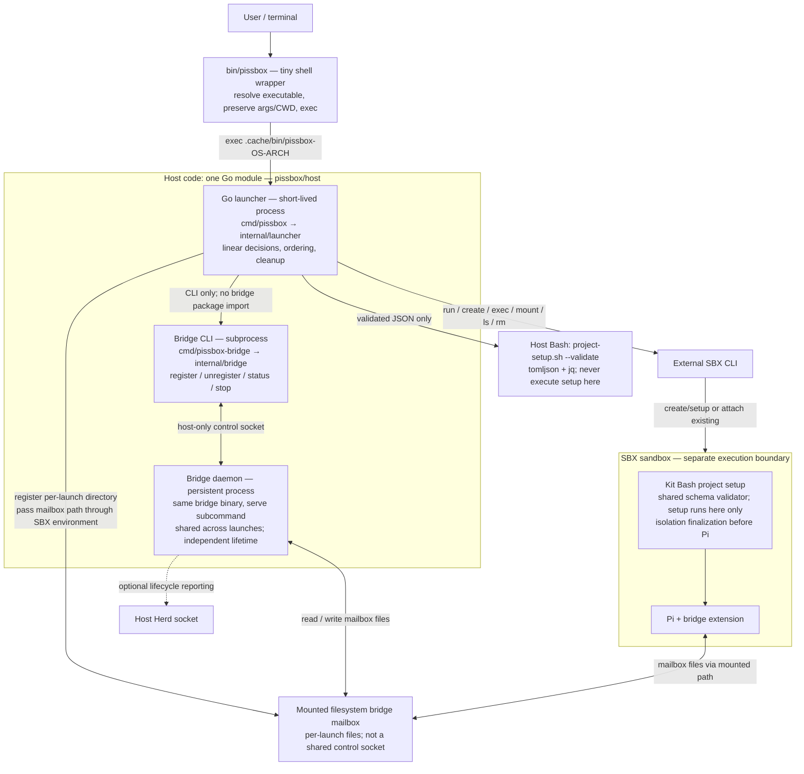

# Go launcher migration

## Goal and scope

Replace the behavioral implementation of `bin/pissbox` with Go while preserving its straightforward, linear orchestration and existing launch behavior. Make launcher decisions accessible to the repository's Go mutation-testing workflow.

This document is a plan only; creating or editing it does not authorize starting implementation. Once the user authorizes a phase on the dedicated migration branch, the implementing agent may commit that phase's changes at sensible checkpoints without asking for each commit. Dependency installation and sandbox recreation still require separate authorization.

## Decisions and constraints

- Use one Go module for host code, with separate launcher and bridge executables. The persistent bridge daemon and short-lived launcher retain independent lifecycles.
- Prepare the existing bridge layout first, before adding launcher implementation. Keep this structural change separate from behavior changes.
- Keep the bridge CLI/mailbox protocol unchanged during migration. Sharing a module does not require sharing daemon internals with the launcher.
- Use the Python subprocess tests as the compatibility specification during the port. Later, move behavioral coverage into Go tests for mutation testing; retain or port useful end-to-end acceptance tests. Permanent test-language choices are not a blocker.
- Keep shell where it is appropriate: sandbox project setup and, if needed, a small host executable-selection wrapper. Host behavior and safety decisions move to Go.
- Preserve one shared project-schema validator initially. The current host path invokes `project-setup.sh --validate`; removing Bash, tomljson, or jq is not part of the initial port.
- No command framework, generic state-machine framework, speculative shared packages, or broad dependency-injection layer. Introduce narrow test seams at actual IO boundaries.
- Preserve unrelated working-tree changes. Reinspect `git status --short` and the current diff at execution time; do not reset, stash, or overwrite ongoing work. The compatibility reference is the working-tree launcher and tests, not a clean version from Git.
- Do not fix unrelated launcher quirks during translation. If source and tests disagree or a new safety issue appears, record the exact case and ask before changing the contract.
- Go tests are added with each behavioral slice, not postponed until the entire port works. Python tests provide transition confidence; Go tests must independently exercise the decisions that mutation testing will assess.

## Execution protocol for the implementing agent

1. Read this entire plan, root `AGENTS.md`, affected files, and applicable skills. Run `make help`. This plan does not authorize execution by itself; follow the user's requested phase or scope.
2. Work on one authorized phase at a time. Mark one current task `[!]`; mark it `[x]` only after its checks pass. Phase 2 may be one sustained implementation run, but verify its internal slices incrementally. Do not perform the module move, launcher port, default switch, and cleanup in one unverified batch.
3. At each phase boundary, record changed paths, exact commands, actual results, manual checks, deviations, and outstanding failures in the execution record below. Stop for human review and authorization of the next phase. A new session is optional: continue or restart using this same plan and current repository state. Do not silently skip unavailable checks or label a dry run a mutation assessment.
4. A failure with no recorded baseline explanation blocks advancing. Missing tools, uncertainty about an external contract, or a need for a new dependency must be reported rather than bypassed. No weakening assertions, blanket mutation exclusions, automatic tool installation, or contacting the real bridge to make checks pass.
5. The user will provide a dedicated migration branch. Confirm the current branch before implementation; do not guess or switch branches automatically. Commits within the authorized phase are permitted under the rules below. Dependency installation, destructive cleanup outside the approved phase scope, real SBX creation/deletion, and publication still require separate authorization. Never use `git add -A` against unexplained private/unrelated files.

## Commit rules

- Use as many commits per phase as make sense for coherent, reviewable changes; there is no one-commit-per-phase requirement or fixed commit count. Do not manufacture tiny commits just to split the work. Committing does not authorize starting the next phase or bypass its review gate.
- Every migration commit subject must begin with `phase N:`, where `N` is the execution phase (1–4). This includes code, tests, tooling, documentation, and plan-status updates. Keep commits within one phase; split changes spanning phase boundaries.
- Examples: `phase 1: relocate bridge into host module`, `phase 2: preserve readiness checks in Go launcher`, `phase 3: switch installed launcher to Go`, `phase 4: remove legacy launcher and duplicate tests`.
- Follow the commit-message skill. Keep the remainder of the subject specific; use the body for meaningful rationale, not test counts or routine verification logs. Stage only reviewed migration files and preserve unrelated work.
- Record checkpoint commit hashes in the phase's execution record so later work can identify its starting point. Do not amend/rewrite existing history or push without authorization.

## Planned implementation defaults

These make the handoff concrete; they are implementation choices proposed by this plan, not additional requirements already agreed in conversation. Resolve objections before implementation, not halfway through the port.

- Module path: `pissbox/host`; Go minimum remains 1.25. No `go.work` or second host module.
- Keep `bin/pissbox` as a tiny shell wrapper at final cutover. Its only jobs are resolving its own symlink chain, selecting the native executable, reporting a missing/unsupported executable, and `exec` with untouched arguments. No automatic compilation, fallback to the old launcher, config parsing, settings changes, bridge calls, menus, or SBX calls in the wrapper.
- Launcher artifacts: `.cache/bin/pissbox-<os>-<arch>` for the same four platforms as the bridge. Preserve `.cache/bin/go-bridge-<os>-<arch>` unchanged. Add `bin/build-launcher` and `make build-launcher` / `make build-launcher-all`; normal `make build` builds both host executables and the image.
- Production resource lookup: derive the checkout root from the symlink-resolved launcher executable under `.cache/bin/`; resources remain checkout-relative. Do not use caller CWD as the install root, bake an absolute checkout path into the binary, or search parent directories. Fake-checkout tests copy the binary into this same layout. Package-level tests may supply a fixture root directly without adding a public CLI override.
- Builds are explicit. Do not implement source hashing, automatic rebuilds, or timestamp freshness machinery. Acceptance tests must build a fresh candidate into isolated fixture storage, not trust a potentially stale installed executable. The wrapper's missing-binary diagnostic identifies the build command.
- Keep the bridge subprocess contract; do not import `internal/bridge` into launcher orchestration. Export only the minimal bridge entrypoint needed by `cmd/pissbox-bridge`; preserve existing exit behavior.
- No new production dependency is assumed. If terminal handling requires one, stop and propose the package, version, need, and installer impact. Do not replace PTY tests with weaker pipe-only tests to avoid the question.

## Target layout

Use a neutral `host/` directory rather than placing the launcher underneath `go-bridge/`:

```text
host/
  go.mod
  cmd/
    pissbox-bridge/
      main.go
    pissbox/                 # Added only after bridge scaffolding is verified.
      main.go
  internal/
    bridge/
      *.go
      *_test.go
    launcher/                # Added during the launcher port.
      *.go
      *_test.go
```

Keep entrypoints thin. Keep existing bridge source files together in one internal package initially; moving out of the module root does not justify splitting each file into its own package. Bridge uses `package bridge`; its existing same-package tests move with it. Launcher uses `package launcher`, with a returning orchestration entrypoint and `os.Exit` only at the executable boundary. An error or nonzero SBX result must not skip bridge cleanup. Do not extract shared packages merely because both programs occupy one module.

## Desired architecture

Target after phase 4. The module groups source/build ownership; its boxes are separate processes, not one combined application. Arrows describe runtime interactions, not Go imports.



- `cmd/` entrypoints stay thin; launcher behavior belongs in `internal/launcher`, bridge behavior in `internal/bridge`. No speculative common framework or cross-import from launcher to bridge.
- The launcher remains alive while a bridge registration is owned; normal cleanup unregisters its own ID, never stops the shared daemon. Owner monitoring handles launcher crashes.
- Host validation and sandbox setup use the same `project-setup.sh` validator. Only sandbox execution may run project setup commands. The isolation identity mailbox is a separate creation handshake, not the bridge mailbox shown above.
- Go behavioral tests exercise launcher/bridge packages and instrumented process boundaries. Existing Python acceptance tests drive the candidate executable during migration; coverage and mutation tooling target Go decisions inside this shared module.

## Behavior ledger required before porting

Record representative test names and remaining gaps for each row when phase 2 starts. Preserve argument ordering, exit status, relevant diagnostics, side-effect ordering, and absence of forbidden calls—not just the final success result. Current source/tests remain authoritative for details this table omits.

| Area | Contract to preserve | Existing evidence |
| --- | --- | --- |
| CLI | Interspersed options, repeated-value precedence, `--`, caller-relative overrides, continue forwarding, empty values, help and management early exits | `tests/test_pissbox_start.py` |
| Management | Validate the entire listing before any deletion; exact physical-directory matching, explicit null workspaces accepted but missing/invalid fields rejected; field-specific rejection diagnostics from current uncommitted work; one separate confirmation, EOF safe, color/NO_COLOR behavior | `tests/test_pissbox_start.py` |
| Paths/config | Launcher symlinks do not change caller CWD; only primary config is read; configured paths relative to primary, not config symlink target; literal strings, ordered physical deduplication with retained CLI spellings; ignore-config-workspaces still validates schema | `tests/test_pissbox_start.py`, `tests/test_project_setup.py` |
| Settings/state | `cm` and `di-7415` select settings-go, others settings-co; preserve regular-file backup and refusal/failure behavior; canonical shared paths; invalid config/isolation checks before settings/state effects | `tests/test_pissbox_start.py`, `tests/test_settings_profiles.py` |
| Ordinary launch/attach | Only supported SBX conflicts enter menu; use reported identity; preserve unrelated/session failure status; Enter/default Pi, case-insensitive immediate keys, invalid-key retry, EOF abort; readiness before Pi/shell, not quit/delete; old kits pass | `tests/test_pissbox_start.py`, `tests/test_isolated_directories.py` |
| Bridge | Optional failure never blocks Pi or replaces SBX status; owner PID stays alive for registered session; fresh registration on reattach; cleanup unregisters only this launch; crash does not kill daemon; complete/partial Herd binding behavior | `tests/test_bridge_launcher.py` |
| Isolation | Ordinary run unchanged when absent/empty; create/defer, mailbox identity without discovery, validate names, recheck path components, mount, verify marker, writable probe, finalize once as UID 1000, register bridge, run Pi; fail closed without replay/remount or automatic deletion | `tests/test_isolated_directories.py`, `tests/test_bridge_launcher.py` |
| Terminal/processes | SBX stdin/stdout retain terminal identity; stderr streams while captured, including on failure; menu reads one key; terminal restored after exit/interruption; cleanup and status preserved on signals | Existing PTY/process cases in launcher/bridge suites; add missing signal/restore cases in Go |

## Known source-layout consumers

This is an inspection seed, not an exhaustive allowlist. Search the tracked tree again before declaring phase 1 complete. Replace source paths, not every occurrence of the name `go-bridge`.

- `bin/build-bridge`: build from `host/` with package `./cmd/pissbox-bridge`, not the module root `.`.
- `Makefile`: test/vet/fmt/tidy working directories, recursive source discovery, syntax list, help examples, and later launcher build targets.
- `tools/quality/run.py`: source root, relative exclusion paths, coverage/CRAP/mutation working directories; recursive nested `cmd/` and `internal/` selection.
- `tools/quality/javascript.mjs`: Stryker copied-file allowlist must include nested host source plus module files, without copying private Pi state or `.cache` artifacts.
- `tests/test_build_bridge.py`, `tests/test_bridge_launcher.py`, `pi-agent/extensions/lib/agent-messaging.test.mjs`: bridge builds now name `./cmd/pissbox-bridge` from `host/`.
- `tests/test_quality.py`: nested fixture tree, exact exclusions, rename destinations, command CWD, Stryker copied-file assertions, and preserved empty-scope behavior.
- Bridge tests: fallback fixture root must still resolve to real checkout `.cache/test-fixtures/` after moving three directory levels below it. Copied-module mutation tests must use the existing explicit fixture-root environment override, not resolve outside the mutation copy by accident.
- `AGENTS.md`, `README.md`, `sbx-kit/README.md`, `KNOWN_ISSUES.md`, `GLOSARY.md`, and `tools/quality/README.md`: current source-layout references and commands. Historical plans may retain old paths; record intentional exceptions.
- `bin/artifacts`, `tests/test_artifacts.py`, `bin/install`, `tests/test_install.py`, `tests/test_make_build.py`: review during cutover. Existing bridge artifact names remain stable; add launcher artifacts, never replace them with daemon-internal names.

## Progress

Checkboxes are the task-status source of truth: `[ ]` pending, `[!]` in progress, `[x]` verified complete. Phase completion includes its review/manual gate, not just finished code. Phase 1 implementation and automated verification are complete; its manual/review gate remains pending.

- [x] Review current launcher, bridge entrypoint/process tests, build/test wiring, quality tooling, and working-tree behavior.
- [x] Record shared contracts, behavior ledger, source-layout consumers, implementation defaults, and desired-architecture diagram.
- [x] Organize one master plan into four separately authorized execution phases with checkboxes and handoff records.
- [ ] Phase 1 complete: bridge relocated and verified with the old launcher.
- [ ] Phase 2 complete: Go launcher implemented, compatibility checked, and mutation-assessed.
- [ ] Phase 3 complete: default switched to Go and manual acceptance approved.
- [ ] Phase 4 complete: old implementation and redundant tests removed, remaining checks verified.

## Tasks

### Phase 1. Relocate the bridge and verify with the old launcher

No launcher implementation or intended bridge behavior changes in this phase. The existing Bash launcher remains the default throughout.

- [x] Record an ordinary-check baseline before changing paths. Inspect the current diff so ongoing launcher work is preserved.
- [x] Move the Go module from `go-bridge/` to `host/`. Move bridge implementation and colocated tests into `internal/bridge`; introduce `cmd/pissbox-bridge/main.go` with a minimal entrypoint into that package.
- [x] Preserve signal handling, diagnostics, exit behavior, detached daemon startup, and self-executable invocation. Existing process tests re-execute their instrumented test binary through `TestMain`; adapt that mechanism without replacing real process tests with in-process mocks.
- [x] Update all source-layout consumers together: `bin/build-bridge`, Make test/vet/fmt/tidy targets, Python tests that build the bridge, JS messaging tests that build it, quality wrappers, Stryker copied-source allowlists, documentation, and repository instructions/examples. Search the whole tracked tree for old source paths; do not rename runtime binary paths indiscriminately.
- [x] Keep `.cache/bin/go-bridge-<os>-<arch>`, bridge protocol versions, host runtime directory selection, and launcher invocation of the bridge unchanged. Review artifact handling and installer checks; update them only where source-layout or dependency changes require it.
- [x] Make coverage, CRAP, and mutation discovery work recursively under the new module. Preserve exact-file selection, rename-destination selection, explicit-base behavior, and refusal to widen empty mutation scopes. Update quality-wrapper regression tests with nested source paths rather than merely renaming the old flat fixture directory.
- [x] Preserve isolated short fixture paths, including `PISSBOX_BRIDGE_TEST_FIXTURE_DIR`, daemon cleanup, and test-result-cache disabling. Verify an unmutated copied-module baseline before trusting mutation results; do not lose subprocess instrumentation while moving the entrypoint.

Verification and review gate:

- [x] Run `make check`; record pre-existing/environmental failures separately from regressions.
- [x] Run `make build-bridge-all` and verify all four existing platform binaries. Cross-compilation is not runtime verification.
- [x] Run `make coverage-go`, exact-file CRAP selection, and a small explicitly selected bridge mutation assessment at the new paths. Inspect baseline failures and uncovered subprocess code rather than treating them as valid kills.
- [ ] With explicit authorization and isolated/disposable resources, manually exercise the old launcher with the relocated bridge: launch, messaging/registration, reattach, normal exit, and interruption/crash cleanup. Verify cleanup releases this launch's registration without terminating the persistent daemon. Record actual commands/results and unavailable platform checks; never use tests to contact the user's real bridge.
- [ ] Record evidence and obtain human acceptance of the bridge move before starting phase 2. A manual check not yet performed remains pending; it is not satisfied by cross-compilation or mocked tests.

### Phase 2. Implement and verify the Go launcher in one sustained run

Keep `bin/pissbox` as the old Bash default throughout this phase. Harness adaptation, translation, Go tests, and mutation assessment belong together. The subsections below are incremental checks inside one phase, not mandatory separate sessions or human handoffs. Do not retire old code or redundant tests yet.

#### Compatibility harness

- [ ] Map the current Python launcher, isolation, and bridge-launcher cases to the behavior ledger, including current working-tree behavior.
- [ ] Add `cmd/pissbox` and `internal/launcher` with a returning orchestration entrypoint; keep process exit at the executable boundary so cleanup can run.
- [ ] Build a separate fresh Go candidate once per acceptance-test run in `.cache/test-fixtures/`; add one shared Python harness helper for candidate selection/materialization, including copied fake checkouts and symlink launches. Do not compile independently for every test or add production fallback/test-mode behavior.
- [ ] Record exact Bash and Go harness invocations in this plan. Until translation is complete, run focused relevant cases against Go and the full suite against Bash. Every original case needs a Go-candidate result or explicit equivalent-Go-test mapping; an unexplained skip is not parity.
- [ ] Adapt Bash-specific fixtures without weakening their behavioral assertions. A Go `os.Hostname` call bypasses the hostname utility stub: cover profile selection through a narrow Go test seam. Test filesystem failures using real conditions where possible, not an assumption that Go invokes `mkdir`. If a Python injection cannot reasonably exercise Go, retain it for the Bash baseline and map each assertion to a passing Go test before excluding that case from candidate execution. Do not retain shell utility calls solely to satisfy old fixtures.
- [ ] Add launcher build targets and ensure ordinary Go checks and scoped quality tooling discover launcher code. Ordinary tests compile isolated candidates without requiring installed binaries, `make build`, or an image build.
- [ ] Prove instrumented Go process tests early: re-execute the Go test binary through a dedicated test entrypoint, as bridge tests already do. Do not build an ordinary launcher binary inside Go mutation tests and assume its decisions are instrumented.

#### Behavioral slices and Go tests

For each slice: translate the behavior, add corresponding Go tests, run focused Python compatibility cases against both implementations, and run affected ordinary checks. Preserve linear orchestration and concrete data; introduce narrow IO seams, not a universal injected operating-system interface.

- [ ] Port CLI parsing and management operations. Preserve interspersed options, last-value precedence, `--`, help/list/delete early exits, complete metadata validation, exact workspace matching, and deletion confirmation.
- [ ] Port resource resolution, workspace/config handling, settings-profile selection/backups, and shared-state preparation. Preserve caller-relative overrides, physical deduplication with retained CLI spellings, primary-project-relative config paths, and validation-before-side-effects ordering.
- [ ] Keep host configuration processing data-only through the shared validation script; never execute project setup commands on the host.
- [ ] Port ordinary creation and existing-sandbox handling. Preserve supported conflict wording/name checks, unrelated-error propagation, continue arguments, single-key menu choices, EOF, and readiness checks with old-kit compatibility.
- [ ] Port bridge registration and cleanup without changing its CLI contract. Preserve owner PID semantics, fresh attach registrations, optional failure behavior, and the independent daemon lifetime.
- [ ] Port isolated creation as the existing ordered protocol: deferred setup, mailbox identity, path revalidation, backing directories, mounts, marker verification before writable probes, UID 1000 finalization, then Pi. Preserve no-discovery, no-remount, and no-automatic-replay behavior.
- [ ] Verify terminal stdin/stdout remain terminals while stderr streams and is captured for conflict recognition. Exercise actual process/PTY boundaries for interruption, termination, terminal restoration, owner lifetime, and child exit status; command-recording mocks alone are insufficient.

#### Compatibility and mutation verification gate

- [ ] Run all applicable Python launcher/isolation/bridge-launcher compatibility cases against the fresh Go candidate, including failures. Record every implementation-coupled exception and passing Go equivalent in the behavior ledger. The ordinary suite must also still pass with the Bash default.
- [ ] Audit Go tests across all ledger areas, particularly invalid config before effects, exact deletion matching, readiness before attach, verified mounts before writes/setup, no replay, conflict classification, and bridge failures not replacing SBX status. Production orchestration must remain readable in execution order.
- [ ] Run ordinary checks before fresh coverage/CRAP and scoped mutation runs through existing Make targets. Prove an unmutated copied-host-module test run passes; supply isolated fixture resources explicitly instead of assuming resources exist outside the copied module.
- [ ] Complete a scoped mutation assessment of at least one real launcher decision file. Inspect survivors, uncovered code, invalid mutants, and timeouts. Fix subprocess instrumentation gaps; parser-only results do not establish launcher stability. Record concrete gaps without inventing a numeric threshold or claiming unrelated failures as kills.
- [ ] Record changed paths, harness commands/results, test mappings, mutation evidence, and outstanding gaps. Obtain human acceptance before switching the default in phase 3.

### Phase 3. Switch to Go and perform manual acceptance

Switch only after phase 2 acceptance. Keep the old implementation available as an explicit compatibility reference until manual acceptance passes; never fall back automatically.

- [ ] Preserve the old working-tree Bash launcher as `bin/pissbox-legacy` before replacing `bin/pissbox`. Keep its required isolation helper and explicit test-harness selection working through this phase. This temporary reference is not selected automatically by the wrapper.
- [ ] Implement the planned tiny-wrapper contract and native binary naming. Preserve launcher symlink chains and caller CWD. `~/.local/bin/pissbox` continues to point to checkout `bin/pissbox`; the wrapper must not regain behavioral logic.
- [ ] Wire explicit launcher compilation into build/install and artifact export/import. Preserve refusal to overwrite regular user files, bridge filenames, and native-host selection despite inherited GOOS/GOARCH. Verify all four launcher cross-build targets and missing-binary diagnostics; no automatic rebuilding/fallback.
- [ ] Align `bin/install`, installer/build/artifact tests and help, README requirements, and operational guides. Retain dependencies required by shared shell validation. Ordinary Python tests must build/select the fresh Go candidate without requiring installed artifacts.
- [ ] Run `make check` with Go as the default and verify the explicit legacy-reference harness still works. Record real regressions separately from previously recorded environment gaps.
- [ ] With explicit authorization and disposable test sandboxes, manually verify ordinary create, existing attach, continue, shell, isolation creation/ready attach, failure/readiness refusal, interruption/terminal restoration, and bridge registration/cleanup. Verify no automatic setup replay or daemon shutdown. Exercise list/delete safely only on disposable resources. Record exact scenarios/results, platforms tested, and unavailable checks.
- [ ] Obtain human acceptance of the Go default and record it before phase 4. Unperformed manual checks remain pending, not silently waived by passing automated tests.

### Phase 4. Remove the old launcher and redundant tests

Cleanup follows accepted Go behavior, not merely a successful build. Do not redesign behavior during removal.

- [ ] Remove `bin/pissbox-legacy` and the obsolete isolation helper after confirming no remaining consumers. Retain the new tiny `bin/pissbox` wrapper.
- [ ] Remove redundant Python cases only where equivalent Go behavioral assertions exist and are exercised. Record retained acceptance suites and removed-case-to-Go-test mappings. Retain or port useful end-to-end tests; do not delete cases solely because they are Python.
- [ ] Remove temporary dual-implementation harness selection and obsolete fixtures/build paths. Keep the fresh-candidate acceptance harness needed by retained tests. Update the Bash syntax target so removal cannot leave an unmatched `bin/lib/*.sh` glob.
- [ ] Update docs/instructions and search for stale source paths, legacy-launcher references, and old test commands. Keep intentional historical references clearly distinguished from runnable instructions.
- [ ] Run `make check` and fresh scoped coverage/CRAP plus relevant launcher mutation checks after cleanup. Confirm tests still reach production decisions and no removed suite supplied unique assertions. Verify build/artifact paths remain valid without legacy files; rerun focused runtime checks if cleanup affects wrapper/install behavior.
- [ ] Record final evidence, retained test coverage, and unresolved platform/environment gaps. Obtain human review and mark the phase-completion checkbox only after its acceptance criteria pass.

## Verification notes

- Start execution with `make help` and the current quality-tooling guide. Use repository wrappers rather than direct coverage/mutation commands.
- Use exact implementation files for initial metrics/mutation checks; preview selection first. Do not assume a feature base or fetch one automatically.
- Never contact or stop the user's real bridge daemon during tests. Use isolated fixtures beneath `.cache/test-fixtures/`.
- No full image build is inherently required for a host-only port that leaves kit scripts and contracts unchanged. If kit behavior changes, reassess image/new-sandbox verification separately.
- Planning/review inspection ran `make help`, read source/tests/tooling, and inspected the working-tree diff. No test/build/metrics baseline had been run at planning time; phase 1 execution evidence is recorded below.

## Execution record

Planning/review is complete; phase 1 is in progress. Fill this in at phase boundaries and add detailed evidence below the table as needed. Later phases must read earlier results, decisions, and gaps. Keep one master plan; a fresh context window is optional, verified work and human approval are not.

| Phase | Status | Commands/results | Remaining gaps or blockers |
| --- | --- | --- | --- |
| Planning/review | Complete | Source/tests/tooling inspected; `make help` and prior whitespace check run | No implementation or runtime verification performed |
| 1. Bridge relocation + old-launcher verification | Automated work verified; awaiting manual/review gate | `make check`, four cross-builds, coverage, exact-file CRAP, copied-module baseline, and scoped mutation assessment passed with short fixture override; details below | Real SBX/Herd checks not authorized/performed; macOS and Linux amd64 runtime unverified; inherited mutation gaps recorded below |
| 2. Go launcher implementation + automated verification | Pending | Not run | Harness, behavioral port, Go tests, copied-module baseline, and mutation assessment |
| 3. Go cutover + manual acceptance | Pending | Not run | Build/install wiring and authorized real SBX checks; legacy reference retained |
| 4. Cleanup + final verification | Pending | Not run | Accepted cutover required before old code/test removal |

### Phase 1 execution — 2026-10-26

**Checkpoint:** `9c6e18a` — `phase 1: relocate bridge into host module`.
Started on `refactor/bash-to-go-migration` at `ee3d918` with a clean working tree.
The earlier missing worktree-metadata mount was resolved before execution.
Phase 2 has not started. Phase 1 completion remains unchecked until manual
verification and human acceptance.

Changed paths:

- Relocated `go-bridge/go.mod`, guide, implementation, and tests to `host/`;
  added `host/cmd/pissbox-bridge/main.go`. Module is `pissbox/host`, Go minimum
  remains 1.25.0, and no dependencies were added.
- Updated `bin/build-bridge`, `Makefile`, bridge-building Python/JS tests,
  `tools/quality/run.py`, `tools/quality/javascript.mjs`, and nested quality
  regression fixtures in `tests/test_quality.py`.
- Updated current source links/examples in `AGENTS.md`, `README.md`,
  `sbx-kit/README.md`, `KNOWN_ISSUES.md`, `GLOSARY.md`, and quality/bridge guides.
- `bin/pissbox`, its isolation helper, kit behavior, runtime artifact names,
  protocol versions, and `bin/install` are unchanged. Installer/artifact/build
  consumers were reviewed; no prerequisite or artifact changes were needed.

Baseline and environment:

- `git status --short`, `git branch --show-current`, `git diff --stat`,
  `git log -5 --oneline`, and `make help` ran before implementation.
- Plain `make check` failed in existing Go process tests: the worktree's default
  control socket paths are 113 bytes, beyond the existing 103-byte limit.
- `make test-js test-python vet syntax` stopped at JS: 34 passed, 2 failed from
  112-byte socket paths. Separately, `make test-python vet syntax` ran 213 Python
  cases: 211 passed and the 2 real-daemon launcher cases failed from 113-byte
  socket paths. `make vet syntax` then passed independently.
- The existing fixture-root override was used with the main checkout's shorter,
  repository-owned fixture directory, not a real bridge runtime:
  `PISSBOX_BRIDGE_TEST_FIXTURE_DIR=/Users/bartek_laskowski/Code/pissbox/.cache/test-fixtures`.
  Below, `FIXTURES` denotes exactly that value. Go was 1.27.3, Linux arm64.
- Necessary test/tooling adaptation: Python real-daemon runtime fixtures now honor
  that same override; both mutation adapters preserve explicit overrides rather
  than replacing them with a too-long worktree path. Defaults remain local to
  the checkout. Regression assertions cover the Go adapter's default and override.
  No safety limits, test assertions, or production launcher contracts were weakened.

Verification commands and results:

```bash
PISSBOX_BRIDGE_TEST_FIXTURE_DIR="$FIXTURES" make test-go test-js
PISSBOX_BRIDGE_TEST_FIXTURE_DIR="$FIXTURES" make check
make build-bridge-all
for binary in .cache/bin/go-bridge-{darwin,linux}-{amd64,arm64}; do go version -m "$binary"; done
PISSBOX_BRIDGE_TEST_FIXTURE_DIR="$FIXTURES" make coverage-go
python3 tools/quality/run.py mutation-go --list host/internal/bridge/mailbox.go
PISSBOX_BRIDGE_TEST_FIXTURE_DIR="$FIXTURES" make crap-go FILES=host/internal/bridge/mailbox.go
python3 tools/quality/run.py mutation-go --list host/internal/bridge/herdr.go
PISSBOX_BRIDGE_TEST_FIXTURE_DIR="$FIXTURES" make mutation-go FILES=host/internal/bridge/herdr.go DRY_RUN=1
PISSBOX_BRIDGE_TEST_FIXTURE_DIR="$FIXTURES" make mutation-go FILES=host/internal/bridge/herdr.go
```

- `make check` passed: Go race tests without result caching, all 36 JS tests,
  all 213 Python tests (including real-daemon crash/isolation cases), vet,
  Bash syntax, and whitespace checks. The real Stryker literal-path regression
  ran, including nested host-source/module copying and private-file exclusion.
- All four bridge cross-builds succeeded. `go version -m` confirmed each binary's
  GOOS/GOARCH, CGO_ENABLED=0, and `pissbox/host/cmd/pissbox-bridge` package.
  An attempted `file` inspection was unavailable; Go build metadata supplied the
  verification instead, without installing anything. Cross-builds are not runtime
  verification for macOS or Linux amd64.
- Native `.cache/bin/go-bridge-linux-arm64 --help` printed unchanged usage;
  `invalid-operation` printed the existing diagnostic and exited 1. These commands
  never resolve/contact the user's daemon.
- Fresh coverage: bridge package **85.6%**, module **85.5%**. CLI `run`/`Main`
  both **100%**, `controlCLI` **90.2%**, `serve` **82.7%**; subprocess coverage
  survived the move. The one-call `cmd/pissbox-bridge/main.go` boundary has **0%**
  instrumented coverage; real-binary Python/JS checks exercise it separately.
- Exact-file CRAP selected only `internal/bridge/mailbox.go`: 4 functions,
  scores 12.00, 9.05, 7.39, 5.00; none above 30. go-crap's per-function coverage
  convention differs from `go tool cover`; no cross-tool comparison is implied.
- Before mutation, copied the whole unmutated `host/` module to
  `.cache/test-fixtures/phase1-copy-9k6byrox/host` and ran the existing target:
  `PISSBOX_BRIDGE_TEST_FIXTURE_DIR="$FIXTURES" make -f "$ROOT/Makefile" -C "$ROOT/.cache/test-fixtures/phase1-copy-9k6byrox" test-go`.
  It passed. The small Python copy harness was necessary because no target
  materializes an unmutated copied module; the tests themselves used Make.
- Scoped mutation assessment (not just the dry run): **13 killed, 3 survived,
  1 uncovered; 0 timeouts, 0 invalid, 0 skipped**. Tool efficacy **81.25%**,
  mutator coverage **94.12%**. The copied baseline passed and subprocess paths
  are covered; no unrelated baseline failures were counted as kills.
- Surviving pre-existing gaps: `herdr.go:27` timestamp-boundary/negation mutants
  show no deterministic test for equal/backward timestamps; the sequence increment
  arithmetic at line 28 is uncovered. The line-76 error-field mutant survives
  because rejection assertions do not independently isolate an otherwise-valid
  result carrying a non-null error. These are recorded, not fixed in a structural
  migration or declared equivalent.
- Compared every relocated Go file against its original Git contents with a
  Python assertion: only package names, exported entrypoint name/comment,
  `TestMain` invocation, and fixture fallback depth differ. `git diff --check`
  and staged whitespace checks passed. Whole tracked-tree `git grep -n
  'go-bridge' -- ':!plan-launcher-migration.md'` found only intentional stable
  runtime binary/stub names; this plan intentionally retains old paths describing
  the migration source and historical inspection seed.

Reports are in `.cache/coverage/go/`, `.cache/crap/go/report.json` (mailbox only),
and `.cache/mutation/go/report.json` (herdr only). Captured baseline/check/quality
logs are under `.cache/test-fixtures/phase1-evidence-dbdirc5i/`.

**Pending gate:** no real SBX creation, reattach, Herd messaging/lifecycle smoke
check, or manual interruption/crash scenario was performed. SBX is not installed
in this sandbox; installation and disposable sandbox operations require separate
permission. Automated isolated-daemon tests do not satisfy this gate. The user's
actual persistent bridge was never contacted or stopped. Obtain authorized manual
checks and human acceptance before marking phase 1 complete or starting phase 2.
